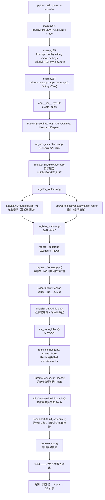
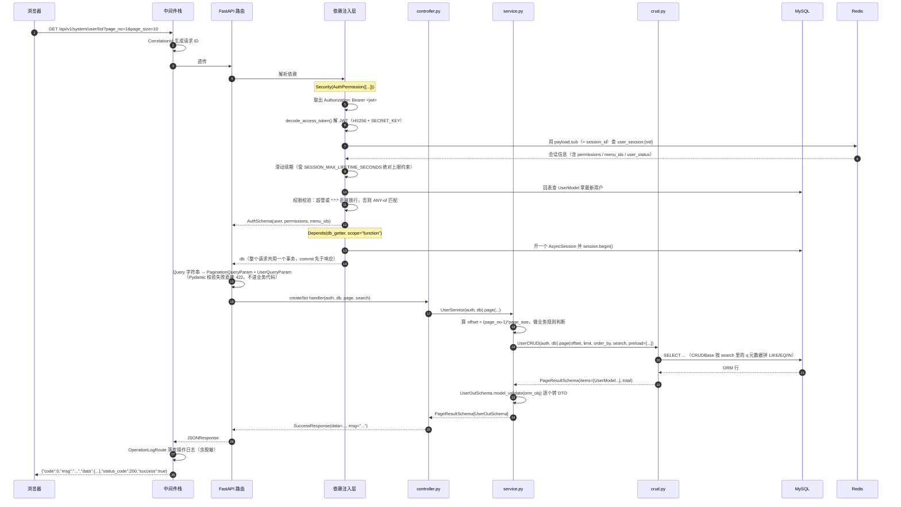

# KAKA Backend 工程架构指南

> 面向读者：**有扎实前端工程基础、刚开始学 FastAPI** 的开发者。
> 全文用前端概念做类比，但会明确标出**类比失效的地方**——那些恰好是后端最容易踩坑的位置。
> 所有结论都基于当前 `dev` 分支实际代码，标注了 `文件:行号`，可以边读边跳转核对。

---

## 1. 先建立整体心智模型

这是一个 **FastAPI 后台管理脚手架**，技术栈与前端工程的对应关系：

| 后端 | 作用 | 前端类比 | 类比是否成立 |
|---|---|---|---|
| `main.py` | CLI 入口（typer） | `package.json` 的 `scripts` | ✅ 基本成立 |
| `uvicorn` | ASGI 服务器，带热重载 | `vite dev` | ✅ 成立 |
| `app/__init__.py:create_app()` | 应用工厂 | Vue 的 `createApp()` | ✅ 几乎一一对应 |
| `FastAPI` | Web 框架 | Express / Koa / NestJS | ✅ 更像 NestJS（有 DI） |
| `APIRouter` | 路由模块 | `vue-router` 的路由表分片 | ✅ 成立 |
| `Pydantic Schema` | 请求/响应数据契约 | TS `interface` + `zod` 合体 | ⚠️ **部分成立，见 §7.5** |
| `SQLAlchemy Model` | ORM 表定义 | Prisma schema | ✅ 成立 |
| `alembic` | 数据库迁移 | `prisma migrate` / knex migration | ✅ 成立 |
| `Depends()` / `Security()` | 依赖注入 | NestJS 的 DI / React Context | ⚠️ **是「每请求」的，不是单例** |
| `pyproject.toml` + `uv.lock` | 依赖清单 + 锁文件 | `package.json` + `pnpm-lock.yaml` | ✅ 成立 |
| `pydantic-settings` | 环境变量读取 + 类型校验 | `import.meta.env` 的强类型封装 | ✅ 成立，但**多了运行期校验** |

**最重要的一条差异**：前端的状态活在浏览器里、跟着页面生命周期走；后端的状态活在**进程 + 数据库 + Redis** 三处，且进程可能被多 worker 复制。这个工程里很多看起来"绕"的设计（Redis 会话存储、调度器分布式锁、SSE 的 Redis pub/sub）都是在解决"多进程共享状态"这一个根问题。

---

## 2. 顶层目录结构

```
backend/
├── main.py                 # CLI 入口：run / revision / upgrade 三个命令
├── alembic.ini             # alembic 配置（script_location = app/alembic）
├── pyproject.toml          # 依赖与工具配置
├── uv.lock                 # uv 锁文件（本项目用 uv 管理依赖）
├── requirements.txt        # pip 兼容的依赖清单
├── banner.txt              # 启动横幅 ASCII art
│
├── app/                    # ★ 全部应用代码
│   ├── __init__.py         # 应用工厂 create_app() + 生命周期 lifespan()
│   ├── config/             # 配置层：路径常量 + Settings
│   ├── common/             # 契约层：响应体、枚举、dataclass、常量表
│   ├── core/               # ★ 框架层：ORM 基类、DB、鉴权、异常、中间件、插件发现、调度器
│   ├── modules/            # ★ 业务层：25 个功能模块（核心，显式注册路由）
│   ├── plugin/             # ★ 插件层：8 个可插拔模块（自动发现注册路由）
│   ├── api/v1/routers.py   # 核心模块的路由总表（DOMAIN_CONTROLLERS）
│   ├── utils/              # 工具函数集
│   ├── scripts/            # 数据库初始化脚本
│   └── alembic/            # 迁移环境 + 版本脚本
│
├── env/                    # 环境配置（.env.dev / .env.prod，不入库；.env.example 入库）
├── sql/                    # 种子数据 JSON（建库后自动灌入）
├── static/                 # 静态资源（上传文件落在 static/upload）
├── templates/              # Jinja2 模板（代码生成器用）
├── data/                   # ip2region 离线 IP 归属地库
├── logs/                   # 运行日志
└── tests/                  # 测试
```

### ⚠️ 两个会让新手困惑的历史残渣

1. **`app/api/v1/module_*` 那 8 个目录是空壳**（`module_ai`、`module_common`、`module_generator`、`module_monitor`、`module_platform`、`module_storage`、`module_system`、`module_task`），里面 0 个 `.py` 文件，只剩 `__pycache__`。这是重构 `app/api/v1/module_xxx/` → `app/modules/xxx/` 之后留下的空目录。git 不跟踪空目录，所以 `git status` 里看不见它们。**可以直接删掉**，不影响任何功能。
   - `app/api/` 下真正活着的只有 3 个文件：`__init__.py`、`v1/__init__.py`、`v1/routers.py`。

2. **`app/plugin/` 与 `app/modules/` 有重名模块**（如两边都有 `module_task`、`module_ai`、`module_generator`）。这是脚手架演进过程中的双轨并存，详见 §8。

---

## 3. 启动全链路



### 3.1 三个新手必踩的点

**① 配置是延迟加载的。** `main.py:31` 先写 `os.environ["ENVIRONMENT"]`，**然后**才 `from app.config.setting import settings`（`:35`）。因为 `Settings` 的 `env_file` 是用 `os.getenv('ENVIRONMENT')` 拼出来的（`app/config/setting.py:17`）。

> 前端类比失效点：Vite 的 `import.meta.env` 在构建期就被静态替换了；这里的配置是**运行期**根据环境变量决定读哪个文件。所以任何在 `import` 期就求值的模块级代码，都可能读到错误的配置。这就是 `lifespan` 里所有 import 都写在**函数体内部**的原因（`app/__init__.py:22-28`）—— 延迟到配置就绪之后再导入。

**② 中间件是倒序注册的。**

```python
# app/__init__.py:69-74
def register_middlewares(app: FastAPI) -> None:
    for middleware in settings.MIDDLEWARE_LIST[::-1]:   # ← 注意 [::-1]
        if not middleware:
            continue
        middleware = import_module(middleware, desc="中间件")
        app.add_middleware(middleware)
```

FastAPI/Starlette 的 `add_middleware` 是**往外层套**的：最后添加的在最外面、最先执行。所以配置列表里写的顺序（`setting.py:261` 的 `MIDDLEWARE_LIST`）是"从外到内"的**期望执行顺序**，注册时必须反过来遍历。

`MIDDLEWARE_LIST` 的实际内容（`app/config/setting.py:261-271`）：

| 顺序 | 中间件 | 作用 |
|---|---|---|
| 1 | `CustomHTTPSRedirectMiddleware` | 仅 PROD：非 HTTPS 请求 301 跳转（认 `X-Forwarded-Proto`） |
| 2 | `CustomTrustedHostMiddleware` | 仅 PROD：Host 头白名单校验 |
| 3 | `CustomCORSMiddleware` | 跨域 |
| 4 | `RequestLogMiddleware` | 请求日志 + 演示模式写拦截 + IP 黑白名单（名单存 Redis `system_config:*`） |
| 5 | `CustomGZipMiddleware` | 超过 `GZIP_MIN_SIZE` 才压缩 |
| 6 | `CorrelationIdMiddleware` | 生成/透传 `X-Correlation-ID`，写入 loguru 上下文 |

**③ 路由有两个注册来源。** 这是理解本工程的**关键分叉**：

- **核心模块**走 `app/api/v1/routers.py` 的显式表驱动：
  ```python
  # app/api/v1/routers.py:32-64
  DOMAIN_CONTROLLERS: dict[str, list[APIRouter]] = {
      "/system":    [AuthRouter, UserRouter, RoleRouter, MenuRouter, DeptRouter,
                     PositionRouter, DictRouter, ParamsRouter, NoticeRouter,
                     TicketRouter, VersionRouter, LogRouter],
      "/monitor":   [CacheRouter, HealthRouter, OnlineRouter, ServerRouter],
      "/task":      [CronJobRouter, CronJobNodeRouter, StorageBrowseRouter,
                     StorageNodeRouter, StorageTransferRouter, StorageWorkflowRouter],
      "/ai":        [ChatRouter],
      "/generator": [GenRouter],
      "/common":    [FileRouter],
  }
  ```
  新增核心模块**必须**在这里登记，否则路由不生效。

- **插件**走 `app/core/discover.py` 的自动扫描，**不需要任何外部登记**，见 §8。

两条路最终都挂在 `settings.ROOT_PATH = "/api/v1"`（`setting.py:47`）之下，所以完整 URL 形如 `/api/v1/system/user/list`、`/api/v1/app/login/password`。

### 3.2 CLI 命令

`main.py` 用 typer 定义了三个命令：

| 命令 | 作用 | 对应前端操作 |
|---|---|---|
| `python main.py run --env=dev` | 启动服务（`DEBUG=True` 时自动开热重载） | `pnpm dev` |
| `python main.py revision --env=dev -m "说明"` | 对比模型与库结构，生成迁移脚本 | `prisma migrate dev --create-only` |
| `python main.py upgrade --env=dev` | 应用迁移到 head | `prisma migrate deploy` |

> 注意：`run` 启动时 `lifespan` 里已经**自动**做了迁移（`app/scripts/initialize.py:52`），所以日常开发不需要手动跑 `upgrade`。dev 环境甚至会在检测到模型变更时**自动生成并应用**迁移（`initialize.py:89-97`）—— 这个自动化很方便，但也有风险，见 §12。

---

## 4. 一次请求的完整旅程

以 `GET /api/v1/system/user/list` 为例，这是最能体现分层的接口。



### 4.1 认证机制的关键设计

**JWT 的 `sub` 存的是 session_id，不是 user_id。**（`app/core/dependencies.py:90-189`）

流程是：解 JWT → 拿 `sub` 当 session_id → 去 Redis 查 `user_session:{session_id}` → 再回数据库查用户。

> 为什么要多绕一层 Redis？因为纯 JWT 是**无状态**的，签出去就没法撤回。加了服务端会话存储之后才能做到：
> - 管理员强制某个用户下线（删 Redis key 即可）
> - 滑动过期（每次请求续期，但有绝对上限）
> - 多端会话管理（一个用户多个 session_id）
>
> 前端类比：JWT 相当于一张"寄存牌"，牌子上写的是柜子编号（session_id），真正的东西在柜子（Redis）里。牌子可以伪造不了，但柜子可以被清空。

**权限校验**用 `AuthPermission`（`app/core/dependencies.py:192-234`）：

```python
# app/modules/system/user/controller.py:121-128
@UserRouter.post("/create", status_code=status.HTTP_201_CREATED,
                 response_model=ResponseSchema[UserOutSchema])
async def create_user_controller(
    auth: Annotated[AuthSchema, Security(AuthPermission(["module_system:user:create"]))],
    db: Annotated[AsyncSession, Depends(db_getter, scope="function")],
    data: Annotated[UserCreateSchema, Body(description="创建用户参数")],
) -> JSONResponse:
    result_dict: UserOutSchema = await UserService(auth, db).create(data=data)
    return SuccessResponse(data=result_dict, msg="创建用户成功")
```

- 超级管理员、或持有 `*` / `*:*:*` 通配权限 → 直接放行
- 否则对传入的权限码列表做 **ANY-of** 匹配（有一个命中即可）
- 不匹配 → 抛 `CustomException`，403

权限码命名约定：`module_<组>:<功能>:<动作>`，例如 `module_system:user:create`、`module_task:storage:browse:upload`。这些码与后台「菜单管理」里的菜单记录一一对应。

**两种写法**：
- handler 里需要用到当前用户 → 写成参数：`auth: Annotated[AuthSchema, Security(AuthPermission([...]))]`
- 只需要拦截、不需要用户 → 写成路由级依赖：`dependencies=[Security(AuthPermission([...]))]`（`system/user/controller.py:162`）
- 只要求登录、不校验具体权限 → `Security(get_current_user)`（`system/user/controller.py:34`）

### 4.2 事务边界

`db_getter`（`app/core/dependencies.py:21`）在 `session.begin()` 里开会话，**整个请求是一个事务**。所以：

- service / crud 里**不需要**手动 `commit()`，请求正常结束自动提交
- 抛异常自动回滚
- 跨 service 调用天然在同一个事务里（`UserService` 可以直接用 `DeptCRUD`、`RoleCRUD`）

> 前端类比失效点：这跟前端"每个 fetch 各自独立"完全不同。一个请求里改了 3 张表，要么全成功要么全失败。写 service 时可以放心地组合多个 CRUD 操作。

**⚠️ 注入时必须写 `Depends(db_getter, scope="function")`**——这是 FastAPI ≥ 0.106 的一个陷阱：

- 带 `yield` 的依赖默认是 **request scope**：依赖在**响应发出之后**才退出，即 `commit()` 晚于 HTTP 响应；
- 后果一：客户端拿到 200/201 时数据可能尚未提交，若随后提交失败（死锁/约束冲突），客户端收到"成功"但数据实际已回滚——静默数据丢失；
- 后果二：客户端紧接着的下一个请求可能读不到刚写入的数据（实测窗口约 36ms），典型表现是"创建父分类成功后立刻创建子分类"稳定报 404。

`scope="function"` 让会话在响应发出**之前**退出、`commit` 先于响应，两个问题同时消除；SSE 长连接也因此不再占用数据库连接池。

> 注意：依赖缓存键包含 scope，`function` 与 `request` 会各建一个会话（同请求两条连接、两个事务），所以全工程必须统一写 `scope="function"`，不要混用。

**例外**：长任务不能共用请求事务。`task/storage/transfer/engine.py` 自己开独立 session（见其 `:21` docstring），因为它跑在请求生命周期之外。

---

## 5. `app/config/` + `app/common/`：配置与契约层

### 5.1 `app/config/`

| 文件 | 职责 | 关键导出 |
|---|---|---|
| `path_conf.py` | 从项目根推导出的**绝对路径常量**（相当于前端共享的 `paths.ts`） | `BASE_DIR`、`ALEMBIC_VERSION_DIR`、`LOG_DIR`、`STATIC_DIR`、`ENV_DIR`、`SCRIPT_DIR`(=`sql/`)、`TEMPLATE_DIR`、`FRONTEND_DIST_DIR`(=`dist/`)、`BANNER_FILE`、`IP2REGION_DIR`、`IP2REGION_XDB_V4` |
| `setting.py` | 全局类型化配置（pydantic-settings） | `class Settings`、单例 `settings`、`@lru_cache get_settings()`（`:323-328`） |

`Settings` 的加载方式（`setting.py:17-18`）：

```python
env_file = ENV_DIR / f".env.{os.getenv('ENVIRONMENT')}"   # → backend/env/.env.dev
env_file_encoding = "utf-8"
```

大小写敏感、多余字段忽略。配置分区：服务器、文档、日志、CORS、认证/JWT、数据加密、数据库连接池、Redis、验证码、调度器、密码策略、OAuth、微信小程序、httpx、操作日志方法白名单、gzip、可信主机 + `WHITE_API_LIST_PATH`、静态/上传、Swagger 资源、OpenAI。

**计算属性**（`@property`，不是字段，改依赖项会自动跟着变）：

| 属性 | 作用 |
|---|---|
| `ASYNC_DB_URI` | 异步连接串：`mysql+aiomysql` / `postgresql+asyncpg` / `sqlite+aiosqlite` |
| `DB_URI` | 同步连接串：`mysql+pymysql` / `postgresql+psycopg` / `sqlite` |
| `REDIS_URI` | 拼好认证段的 Redis 连接串 |
| `ALLOW_ORIGINS` | PROD 用 `PROD_CORS_ORIGINS`，其余环境 `["*"]` |
| `MIDDLEWARE_LIST` | 中间件清单（PROD 才含 HTTPS 跳转与可信主机） |
| `FASTAPI_CONFIG` | 传给 `FastAPI(...)` 的关键字参数（含 `root_path="/api/v1"`） |

> ⚠️ **`DATABASE_NAME` 的默认值是 `"mysql"`**（`setting.py:104`）。这会让应用连到 MySQL 自带的系统 schema（存 `user`、`db`、`tables_priv` 等权限表）。本项目已因此出过严重事故，见 §12.1。本地 `env/.env.dev` 必须显式改成独立业务库。

### 5.2 `app/common/`

| 文件 | 职责 | 关键导出 |
|---|---|---|
| `response.py` | **统一响应体**——所有 HTTP 回复的形状 | `ResponseSchema[T]`(`:26`)、`SuccessResponse`(`:36`)、`ErrorResponse`(`:70`)、`StreamResponse`、`RedirectContentResponse`、`UploadFileResponse`、`jsonable_response_content()` |
| `enums.py` | 全局枚举 | `EnvironmentEnum`、`BusinessType`、`RedisInitKeyConfig`、`SysParamKey`、`QueueEnum`、`OrderTypeEnum`、`InvoiceTypeEnum`、`TicketTypeEnum`、`RET`（码+文案元组，如 `RET.OK=(0,"成功")`、`TOKEN_EXPIRED=10401`、`NO_PERMISSION=10403`） |
| `dataclasses.py` | 纯数据载体 | `UserAgentInfo`、`RequestCallNext`、`AccessToken`、`RefreshToken`、`NewToken`、`TokenPayload`、`UploadUrl`、`SnowflakeInfo` |
| `request.py` | **非 SQL 数据源**的内存分页（Redis 列表等） | `PaginationService.paginate()` → `PageResultSchema` |
| `constant.py` | 静态常量表 | `CommonConstant`(YES/NO/UNIQUE)、`JobConstant`(定时任务代码沙箱黑白名单)、`GenConstant`(数据库类型→表单控件映射)、日期格式常量 |

**响应体形状**（`app/common/response.py:26`）：

```jsonc
{
  "code": 0,            // 业务码，0 = 成功；错误码见 common/enums.py 的 RET
  "msg": "操作成功",
  "data": { ... },      // 泛型 T，PROD 环境下错误响应的 data 会被抹掉
  "status_code": 200,
  "success": true
}
```

> 这跟前端常见的 `interface ApiResponse<T> { code: number; msg: string; data: T }` **完全同构**。`ResponseSchema[T]` 是 Python 的泛型（`Generic[T]`），写法 `ResponseSchema[PageResultSchema[UserOutSchema]]` 就是 TS 的 `ApiResponse<PageResult<UserOut>>`。

**关键点**：响应体**不是靠装饰器**统一的，而是「返回 `SuccessResponse` 实例 + 声明 `response_model=ResponseSchema[T]`」两件事配合——前者决定实际返回什么，后者决定 OpenAPI 文档里长什么样、并做输出校验。漏写 `response_model` 不会报错，但 Swagger 文档会失真。

---

## 6. `app/core/`：框架层（17 个文件）

这是整个工程最需要读透的一层。按职责分成六组。

### 6.1 数据基座

| 文件 | 职责 | 关键导出 |
|---|---|---|
| `base_model.py` | SQLAlchemy 声明式基类 + 混入 | `NAMING_CONVENTION`、`MappedBase`(`:22`)、`ModelMixin`(`:42`)、`UserMixin`(`:124`) |
| `database.py` | 引擎与会话工厂 | `create_sync_engine()`、`create_async_engine_and_session()`(`:35`)、单例 `engine` / `async_engine` / `async_db_session`(`:90-91`)、`create_tables()`(`:93`)、`drop_tables()` |
| `base_crud.py` | 通用异步仓储（相当于强类型 DAO） | `CRUDBase[ModelType, CreateSchemaType, UpdateSchemaType]`，方法 `get` / `get_or_404` / `exists` / `count` / `get_list` / `page` / `create` / `update` / `delete` / `clear` / `set`；操作符映射 `_OPERATOR_MAP` |
| `base_schema.py` | 通用 Pydantic DTO | `CommonSchema`、`BaseSchema`、`PageResultSchema[T]`、`PaginationQueryParam`(`:136`)、`BaseQueryParam`、`UserByQueryParam`、`AuthSchema`、`JWTPayloadSchema`、`JWTOutSchema`、`SessionInfoSchema`、`OptionSchema`、`UploadResponseSchema`、`DownloadFileSchema`、`BatchSetAvailable` |

**`MappedBase`**（`base_model.py:22`）= `AsyncAttrs + DeclarativeBase`，特性：
- `__tablename__` 自动取类名小写（可覆盖）
- 共享 `MetaData(naming_convention=NAMING_CONVENTION)`，索引/检查/外键/主键都有确定性命名（`uq` 唯一约束故意不命名）

> 确定性命名很重要：alembic autogenerate 靠名字对比数据库与模型。命名不确定 → 每次生成迁移都会认为"索引变了" → 产出大量无意义的 drop/create。

**两个 Mixin 的区别**（这是选型关键）：

| Mixin | 加的列 | 什么时候用 |
|---|---|---|
| `ModelMixin`(`:42`) | `id`(自增主键)、`uuid`(String(64) 唯一，默认 uuid4)、`is_deleted`(软删标记)、`created_time`、`updated_time`、`deleted_time`；外加两个复合索引 `(status, is_deleted)`、`(created_time, is_deleted)` | **默认选这个** |
| `UserMixin`(`:124`) | 在 `ModelMixin` 基础上再加审计外键 `created_id` / `updated_id` / `deleted_id` → `sys_user.id`（`ON DELETE SET NULL`），以及关系 `created_by` / `updated_by` / `deleted_by` | **只有后台管理表才用** |

> ⚠️ **C 端（消费者）表必须只用 `ModelMixin`**，原因有两个：
> 1. `UserMixin` 的外键指向 `sys_user`，C 端用户在 `app_user` 表，外键会指错
> 2. `app/core/permission.py` 的数据范围过滤会按 `created_id` 裁剪查询结果，C 端数据被后台的数据范围规则误伤
>
> `tenant_id` 已在提交 `a222cd9e` 中**全库移除**，多租户相关代码不再存在（全仓 grep `tenant` 在 config/common/core 三层零命中）。

**`async_db_session` 是 `async_sessionmaker[AsyncSession]`**（`database.py:80-87`），不是 session 本身。用法：

```python
async with async_db_session() as session, session.begin():
    ...   # 退出 with 块自动 commit / 异常自动 rollback
```

SQLite 分支额外加了 WAL 与 `busy_timeout` pragma（`database.py:56-62`）。同步 `engine` 只给 APScheduler 的 SQLAlchemy jobstore 和代码生成器用。

**`CRUDBase` 的查询过滤机制**：`get_list(search=...)` / `page(...)` 接收一个 Pydantic 查询对象，经 `search_to_dict()` 转字典后，读每个字段的 `json_schema_extra={"q": "like"}` 元数据决定用哪种操作符（`like` / `eq` / `in` / `gt` / `ge` / `lt` / `le` …）。也就是说**过滤规则声明在 schema 里，执行逻辑在基类里**——业务模块只写声明，不写 SQL 拼接。

### 6.2 认证鉴权三件套

| 文件 | 职责 | 关键导出 |
|---|---|---|
| `security.py` | JWT 编解码 + OAuth2 方案 | `CustomOAuth2PasswordBearer`、`CustomOAuth2PasswordRequestForm`、单例 `OAuth2Schema`、`create_access_token()`、`decode_access_token()` |
| `dependencies.py` | FastAPI 依赖提供者 | `db_getter`(`:21`)、`redis_getter`、`get_current_user`、`get_websocket_token`、`websocket_authenticate`、`_authenticate`(`:90-189`)、`class AuthPermission`(`:192-234`) |
| `permission.py` | **行级数据范围**过滤 | `class Permission`（`filter_query()`）；常量 `DATA_SCOPE_SELF=1`、`DATA_SCOPE_DEPT_AND_CHILD=2`、`DATA_SCOPE_ALL=3` |

`permission.py` 解决的是"同一个接口，不同角色看到不同行"：本人数据 / 本部门及子部门 / 全部。它作用在 `UserMixin` 的 `created_id` + 部门树上——这也是为什么 C 端表不能用 `UserMixin`。

WebSocket 无法用 `Security()`，所以走 `websocket_authenticate`：从 `Sec-WebSocket-Protocol: access_token.<jwt>` 子协议头或 `?token=` 查询参数取令牌（`ai/chat/controller.py:36-44` 是实例，它在 WS handler 里手动做权限判断）。

### 6.3 错误与日志

| 文件 | 职责 | 关键导出 |
|---|---|---|
| `exceptions.py` | 业务异常类型 + 全局处理器注册 | `CustomException`、`require_superadmin` 装饰器、`handle_exception(app)`(`:61`) |
| `logger.py` | loguru 配置 + 请求 ID 上下文 | 单例 `logger`、`setup_logger()`（import 时即执行）、`set/get/reset_correlation_id`、`InterceptHandler`（把标准 logging 接管到 loguru） |
| `router_class.py` | **审计日志路由类** | `class OperationLogRoute(APIRoute)`、`OperationLogRecord` TypedDict、`_redact_sensitive()` |

`handle_exception(app)` 注册的全局处理器覆盖：`CustomException`、Starlette `HTTPException`、`RequestValidationError`（422）、`ResponseValidationError`、`SQLAlchemyError`（其中 `IntegrityError` 细分：唯一键冲突→409、外键约束→409、非空约束→409）、`ValueError`，以及兜底 `Exception`。全部返回 `ErrorResponse`，形状即 §5.2 的信封，PROD 环境下抹掉 `data`。

> 前端类比：等价于 axios 响应拦截器统一处理错误 —— 但发生在服务端，所以业务代码里**只管 `raise CustomException(msg=...)`**，不用关心 HTTP 状态码怎么拼、JSON 怎么序列化。

`OperationLogRoute` 是 `route_class`，挂在 router 上（`UserRouter = APIRouter(route_class=OperationLogRoute, ...)`，`system/user/controller.py:29`）。它拦截每个请求的入参与响应写操作日志，并对敏感字段脱敏（`_redact_sensitive()`）。

> ⚠️ **登录/改密这类接口不能用 `OperationLogRoute`**，否则明文密码会进日志表。脱敏名单是固定的，新加的敏感字段要记得补。

### 6.4 中间件与流式

| 文件 | 职责 | 关键导出 |
|---|---|---|
| `middlewares.py` | ASGI 中间件实现 | 6 个类，见 §3.1 表格 |
| `sse_manager.py` | Server-Sent Events 广播 | `class SSEConnectionManager`、`stop_sse_relays()`、`SSE_QUEUE_MAX_SIZE=64` |

`SSEConnectionManager` 的设计值得学：**进程内用 `asyncio.Queue`，跨进程用 Redis pub/sub**。因为多 worker 部署时，产生事件的进程和持有 SSE 连接的进程很可能不是同一个。

> 前端类比：SSE 就是 `EventSource`。后端这边一个连接 = 一个 queue，`broadcast()` 往所有 queue 塞，`send_to_user(uid, ...)` 只塞给指定用户的 queue。

### 6.5 插件发现

| 文件 | 职责 | 关键导出 |
|---|---|---|
| `discover.py` | 插件路由自动注册 | `class DynamicRouterRegistry`、单例 `dynamic_router`(`:143`)、`check_route_conflicts(app)`(`:112`) |

机制（`discover.py:38-99`）：

1. glob 扫描 `app/plugin/module_*/**/controller.py`（`:52`）
2. 按 `app.plugin.<包名>.controller` 动态 import
3. 目录名去掉 `module_` 前缀 → URL 前缀（`:62-66`）：`module_example` → `/example`，`module_app` → `/app`
4. **遍历 `dir(module)`，把找到的每一个顶层 `APIRouter` 属性都 `include_router`**（`:76-83`，按 `id()` 跨文件去重）
5. 任何一个 controller import 失败 → 抛 `RuntimeError`，**整个应用启动失败**（`:96-99`）
6. 之后 `check_route_conflicts()`（`:112`）检查 (method, 归一化 path) 是否重复注册，重复则启动失败

> ⚠️ **第 4 步是最大的坑**：它不区分"对外的路由"和"内部用的路由"。如果你在 `controller.py` 顶层 `from .internal import someRouter`，或者在顶层定义了任何辅助用的 `APIRouter()`，它都会被当成对外接口暴露出去。
>
> **规矩**：`controller.py` 顶层只放**确实要对外暴露**的 `APIRouter`。内部 router 放到别的文件、或者定义在函数内部。

`ROOT_PATH` 不在 `discover.py` 里，而是 `settings.ROOT_PATH = "/api/v1"`（`setting.py:47`），经 `FASTAPI_CONFIG["root_path"]`（`setting.py:310`）传给 FastAPI。

### 6.6 调度与缓存

| 文件 | 职责 | 关键导出 |
|---|---|---|
| `ap_scheduler.py` | APScheduler 装配 + **分布式主节点锁** | 单例 `scheduler`(AsyncIOScheduler)、`class SchedulerUtil`、`SCHEDULER_LOCK_KEY/TTL/RENEW/POLL`(`:62-65`)、`JOB_STATUS_SUCCESS/FAILED`、`_humanize_job_error()` |
| `redis_crud.py` | Redis 生命周期 + 缓存工具 | `redis_connect(app, status)`、`class RedisCURD`（`get/set/mget/lock/unlock/renew_lock/compare_and_set/ttl/expire/scan_keys/hash_set/hash_get/publish/info/db_size` …） |
| `validator.py` | 可复用的 Pydantic `Annotated` 字段类型与校验器 | `DateTimeStr`、`DateStr`、`TimeStr`、`Telephone`、`Email`；函数 `datetime_validator`、`password_validator`、`mobile_validator`、`code_validator`、`menu_request_validator`、`role_permission_request_validator` |

**调度器配置**（`ap_scheduler.py:67-90`，import 时即完成）：

- jobstores：`default` = `RedisJobStore`（与应用共用 Redis）、`sqlalchemy` = `SQLAlchemyJobStore(engine=engine)`、`memory` = `MemoryJobStore`
- executors：`default` = `AsyncIOExecutor`、`threadpool` = `ThreadPoolExecutor(10)`、`processpool` = `ProcessPoolExecutor(1)`
- `job_defaults`：`coalesce=True`（堆积的触发合并成一次）、`max_instances=5`
- timezone：`Asia/Shanghai`

**多 worker 分布式锁**：Redis 锁 `fastapiadmin:scheduler:lock`，TTL 30s、续期 10s、轮询 5s。**只有持锁进程真正跑调度器**，其余进程轮询等待，持锁者崩溃则接管（`SchedulerUtil.init_scheduler`，`:107`）。

> 这是"多进程共享状态"根问题的典型解法。前端没有对应物——最接近的类比是 `BroadcastChannel` + leader election，或者 SharedWorker 单例。不做这个的话，`WORKERS=4` 时同一个定时任务会被跑 4 次。

`register_system_job` **已在重构中移除**（全仓 grep 零命中）。系统任务不再硬编码，改由 `task/cronjob/node` 的定义 + 数据库种子驱动。

`validator.py` 里的 `Annotated` 类型是**复用校验规则**的手段：

```python
# 用法示意：把「手机号」这个概念连同校验规则一起打包成类型
mobile: Telephone          # 而不是 mobile: str + 到处写 @field_validator
```

> 前端类比：等价于 zod 的 `const PhoneSchema = z.string().regex(...)` 然后到处 `PhoneSchema` 复用。Python 这边用 `Annotated[str, AfterValidator(...)]` 实现同样效果，且能直接当类型注解用。

---

## 7. `app/modules/`：业务层（25 个功能模块）

### 7.1 五层分工

调用方向**严格单向**：`controller → service → crud → model`，`schema` 被前三层共同引用。

| 层 | 文件 | 职责 | 前端类比 |
|---|---|---|---|
| 边界层 | `controller.py` | 定义 `APIRouter`、声明鉴权、解析请求、调 service、包装响应信封。**零业务逻辑** | 路由 handler + 边缘处的 zod parse |
| 业务层 | `service.py` | 业务规则、跨模块编排、ORM→DTO 转换、抛 `CustomException` | Pinia/Redux 的 thunk / usecase |
| 数据层 | `crud.py` | 纯数据访问，继承 `CRUDBase`，只加实体特有查询 | 封装好的 axios/fetch 层 |
| 模型层 | `model.py` | SQLAlchemy ORM 表定义与关系 | Prisma schema |
| 契约层 | `schema.py` | Pydantic 校验 + DTO（Create/Update/Query/Out） | TS interface + zod（合体） |

**层间规矩**（`system/user/` 实测）：
- service **可以**用别的模块的 CRUD（`UserService` 里 import 了 `DeptCRUD`、`RoleCRUD`、`MenuCRUD`，`service.py:11-15`）
- service **不能**用别的模块的 controller
- service **不直接**碰 SQLAlchemy，一律走 CRUD
- CRUD 只管持久化，**校验归 Service**（`crud.py:44-49` 的 docstring 明确写了这条约定）

**service 与 crud 都是每请求 new 出来的，不是单例**：

```python
UserService(auth, db)            # __init__ 接 auth: AuthSchema, db: AsyncSession
UserCRUD(self.auth, self.db)     # 同样按调用构造
```

> 前端类比失效点：NestJS 的 provider 默认是单例；这里刻意做成"带着请求上下文（当前用户 + 会话）的短命对象"。好处是无状态、无并发共享问题、`auth` 天然可用于数据范围过滤。

### 7.2 controller 层实例

```python
# app/modules/system/user/controller.py:29
UserRouter = APIRouter(route_class=OperationLogRoute, prefix="/user", tags=["用户管理"])

# app/modules/system/user/controller.py:121-128
@UserRouter.post("/create", status_code=status.HTTP_201_CREATED,
                 response_model=ResponseSchema[UserOutSchema])
async def create_user_controller(
    auth: Annotated[AuthSchema, Security(AuthPermission(["module_system:user:create"]))],
    db: Annotated[AsyncSession, Depends(db_getter, scope="function")],
    data: Annotated[UserCreateSchema, Body(description="创建用户参数")],
) -> JSONResponse:
    result_dict: UserOutSchema = await UserService(auth, db).create(data=data)
    return SuccessResponse(data=result_dict, msg="创建用户成功")
```

需要掌握的 FastAPI 语法：

| 写法 | 含义 |
|---|---|
| `Annotated[X, Depends(f)]` | 依赖注入：FastAPI 先调 `f`，把返回值当 `X` 类型注入参数 |
| `Annotated[X, Security(f)]` | 同上，但会体现在 OpenAPI 的安全方案里 |
| `Body(...)` / `Query(...)` / `Path(...)` | 声明参数来自请求体 / 查询串 / 路径 |
| `response_model=ResponseSchema[T]` | 声明输出形状，用于文档生成 + 输出校验 + 字段过滤 |
| `status_code=...` | 成功时的 HTTP 状态码 |
| `tags=[...]` | Swagger 里的分组 |

**Pydantic 类型注解本身就是校验器**：`data: UserCreateSchema` 意味着请求体不合法时，FastAPI 在**进入 handler 之前**就返回 422，业务代码根本不会执行。这就是 zod 的位置。

### 7.3 service 层实例

```python
# app/modules/system/user/service.py:42-47
class UserService:
    def __init__(self, auth: AuthSchema, db: AsyncSession):
        self.auth = auth
        self.db = db

# app/modules/system/user/service.py:98-102
async def create(self, data: UserCreateSchema) -> UserOutSchema:
    if data.is_superuser:
        raise CustomException(msg="不允许创建超级管理员")
    if await UserCRUD(self.auth, self.db).get(username=data.username):
        raise CustomException(msg="已存在相同用户名称的账号")
    ...
```

ORM → DTO 的转换发生在 service：`UserOutSchema.model_validate(user)`（`service.py:51`）。

### 7.4 crud 层实例

```python
# app/modules/system/user/crud.py:14
class UserCRUD(CRUDBase[UserModel, UserCreateSchema, UserUpdateSchema]):
    ...

# app/modules/system/user/crud.py:44-49
async def set_user_roles(self, user_objs, role_objs) -> None:
    """替换用户的角色关联（纯数据操作；目标对象加载与校验由 Service 完成）"""
    for obj in user_objs:
        obj.roles.clear()
        obj.roles.extend(role_objs)
    await self.db.flush()
```

`CRUDBase[ModelType, CreateSchemaType, UpdateSchemaType]` 是泛型类，等价于 TS 的 `BaseRepository<TModel, TCreate, TUpdate>`。基类已提供 `get / get_or_404 / get_list / page / create / update / delete / set`，模块 CRUD 只写实体特有的查询。

注意用的是 `flush()` 而不是 `commit()` —— 因为事务由 `db_getter` 统一管（§4.2），这里只需把变更推到数据库、让同一事务内的后续查询能看到。

### 7.5 schema 层：与 zod 的对照

`app/modules/system/user/schema.py` 用**继承**组织 DTO：

```
CurrentUserUpdateSchema (:25  基础字段 + 校验器)
   ├── UserCreateSchema  (:128)
   └── UserUpdateSchema  (:186)   ← ConfigDict(from_attributes=True) (:189)

UserOutSchema (:218)
   └── CurrentUserOutSchema (:240)

UserQueryParam (:253)  ← 继承 BaseQueryParam, UserByQueryParam
```

校验手段：`Field(...)` 约束 + `@field_validator` + `@model_validator`（`schema.py:35-73`）。

| 维度 | zod | Pydantic |
|---|---|---|
| 声明式字段规则 | ✅ | ✅ `Field(...)` |
| 自定义精化 | `.refine()` | `@field_validator` / `@model_validator` |
| 校验失败的结构化错误 | ✅ | ✅ 自动转 422 |
| **运行期存在类型** | ❌ TS 类型编译后擦除 | ✅ **类本身就是运行期类型** |
| **从 ORM 对象构造** | 无对应物 | ✅ `model_validate(orm_obj)` + `from_attributes=True` |
| 区分"未传"与"传 null" | `.optional()` vs `.nullable()` | ✅ `model_dump(exclude_unset=True)`（`service.py:138`） |

最后两行是**类比彻底失效**的地方，也是最值得理解的：

- Pydantic 类同时扮演"TS interface"和"zod schema"两个角色，而且它在运行期真实存在，所以能把 SQLAlchemy ORM 对象**直接转换**成响应 DTO。前端没有这个能力（类型被擦除了）。
- `exclude_unset=True` 让 PATCH 语义正确：`{"name": null}` 是"把名字设为空"，`{}` 是"不改名字"。等价于 TS 的 `Partial<T>`，但**在运行期强制执行**。

**查询参数类**：`app/modules/` 下**没有 `param.py`**（已全量确认）。查询对象写在 `schema.py` 里，靠元数据声明操作符：

```python
# app/modules/system/user/schema.py:262
name: str | None = Field(None, ..., json_schema_extra={"q": "like"})
```

`CRUDBase.get_list(search=...)` 读这个 `q` 值决定生成 `LIKE` 还是 `=` 还是 `IN`。**声明在 schema，执行在基类**，业务模块不写 SQL 拼接。

### 7.6 分页三件套

所有列表接口统一长这样（`system/user/controller.py:95-100`）：

```python
async def list_user_controller(
    auth:  Annotated[AuthSchema, Security(AuthPermission([...]))],
    db:    Annotated[AsyncSession, Depends(db_getter, scope="function")],
    page:  Annotated[PaginationQueryParam, Depends()],   # page_no / page_size / order_by
    search: Annotated[UserQueryParam, Query()],           # 业务过滤条件
) -> ResponseSchema[PageResultSchema[UserOutSchema]]:
```

service 换算 `offset = (page_no - 1) * page_size`（`service.py:79`），`CRUDBase.page()` 返回带 `items` + `total` 的 `PageResultSchema`。导出接口复用同一个 `search` 对象，只是改用 `Body()` 传（`controller.py:181`）。

### 7.7 模块清单

图例：`[C]`controller `[S]`service `[R]`crud `[M]`model `[X]`schema

| 路径 | 领域 | 层 | 备注 |
|---|---|---|---|
| `ai/chat/` | AI 会话（agno 框架，HTTP + WebSocket） | C S R X | **无 model**：`crud.py:7-10` 用 agno 自带的 `AsyncMySQLDb/AsyncPostgresDb/AsyncSqliteDb`，不走 SQLAlchemy |
| `common/file/` | 本地文件上传下载 | C S | 仅 2 层，委托给 `UploadUtil`（`controller.py:11`） |
| `generator/gencode/` | 代码生成器（Jinja2 模板 → 模块脚手架） | C S R M X | 另有 `gen_util.py`、`jinja2_template_util.py` |
| `monitor/cache/` | Redis 缓存监控 | C S X | 无自有表 |
| `monitor/health/` | DB/Redis 健康探针 + SSE 流 | C S X | SSE 在 `controller.py:30-46`，生成器式 |
| `monitor/online/` | 在线用户会话 | C S X | 无自有表（读 Redis） |
| `monitor/server/` | 服务器指标（CPU/内存） | C S X | 无自有表（读 psutil） |
| `system/auth/` | 登录 / 验证码 / OAuth / 微信小程序 | C S X | 拆成 `service.py` + `oauth_service.py` + `wx_mini_service.py`；无 crud/model，复用其他模块的 CRUD |
| `system/dept/` | 部门（树形） | C S R M X | |
| `system/dict/` | 数据字典（类型 + 数据） | C S R M X | 启动时预热进 Redis |
| `system/log/` | 登录日志 + 操作日志 | C S R M X | |
| `system/menu/` | 菜单/权限（树形） | C S R M X | 权限码的来源 |
| `system/notice/` | 公告 + SSE 广播 | C S R M X | 另有 `stream.py` |
| `system/params/` | 系统参数 | C S R M X | 启动时预热进 Redis |
| `system/position/` | 岗位 | C S R M X | |
| `system/role/` | 角色 + 权限分配 | C S R M X | |
| `system/ticket/` | 工单 | C S R M X | |
| `system/user/` | 用户 | C S R M X | **本文档的参考实现** |
| `system/versions/` | 应用版本管理 | C S R M X | |
| `task/cronjob/job/` | 定时任务**执行日志**（表 `task_corn_job`） | C S R M X | `job/model.py:7-11` |
| `task/cronjob/node/` | 定时任务**定义**（触发器/目标函数/参数） | C S R M X | 另有 `handlers/demo_handler.py` 示例可调用体 |
| `task/storage/browse/` | 存储源上的即席文件浏览/上传 | C S X | 无 crud/model，直接走适配器 |
| `task/storage/core/` | **非功能模块**——存储适配器基础设施 | — | `base.py`(ABC) + `factory.py` + 7 个适配器 |
| `task/storage/node/` | 存储源连接配置（`StorageNodeModel`） | C S R M X | |
| `task/storage/transfer/` | 文件传输任务（并行/串行执行） | C S R M X | 另有 `engine.py`、`registry.py`、`sse_manager.py` |
| `task/storage/workflow/` | 可复用传输流程（源→多目标图，存 VueFlow 画布 JSON） | C S R M X | `workflow/model.py:18-19` |

> 注：`app/modules/task/` 下**没有** `workflow/` 子包；工作流在 `task/storage/workflow/`。

### 7.8 存储适配器：本工程最好的设计模式教材

```
app/modules/task/storage/core/
├── base.py               # BaseStorageAdapter 抽象基类
├── factory.py            # protocol → adapter 类的字典映射 + create()
├── local_adapter.py      # 本地磁盘
├── s3_adapter.py         # AWS S3
├── oss_adapter.py        # 阿里云 OSS
├── obs_adapter.py        # 华为云 OBS
├── cos_adapter.py        # 腾讯云 COS
├── sftp_adapter.py       # SFTP
└── ftp_ftps_adapter.py   # FTP / FTPS
```

- `factory.py:12-21` 是 `protocol → adapter class` 字典，`StorageAdapterFactory.create(config)`（`:27-32`）按配置实例化对应适配器。
- `base.py` 的 docstring 写明了设计意图：**子类只实现同步的 `_sync_*` 方法，基类统一用 `asyncio.to_thread` 包成异步**，避免阻塞事件循环。

> 这是"同步 SDK + 异步框架"的标准桥接手法。绝大多数对象存储 SDK（boto3、oss2）都是同步阻塞的，直接在 `async def` 里调用会卡死整个事件循环——所有并发请求一起等。`asyncio.to_thread` 把它丢到线程池。
>
> 前端类比：类似把 CPU 密集任务丢给 Web Worker，只不过这里是 IO 密集任务丢给线程。

`transfer/` 目录展示了**长任务该怎么组织**：

| 文件 | 职责 |
|---|---|
| `engine.py` | 传输执行器，**开自己独立的 DB session**（`:21` docstring），跑在请求生命周期之外 |
| `registry.py` | 内存中的**取消标志注册表**（`:4-20`）——注意这不是持久化，仅适用单实例部署 |
| `sse_manager.py` | 用 `SSEConnectionManager(channel=...)` 推送传输进度（`:5`） |

### 7.9 SSE 的两种实现

工程里有 3 个 SSE 端点，用了两种机制，对比着看很有教益：

**① 生成器式（无 manager）** —— 适合"定时轮询推快照"：

```python
# app/modules/monitor/health/controller.py:30-46
async def health_stream(...):
    while True:
        yield ServerSentEvent(raw_data=...)
        await asyncio.sleep(30)
```

**② manager 式（pub/sub）** —— 适合"事件驱动推给特定用户"：

```python
# app/modules/system/notice/stream.py:5
manager = SSEConnectionManager(channel="...")

# app/modules/system/notice/controller.py:99-117
queue = asyncio.Queue()
await manager.connect(auth.user.id, queue, redis=...)
# 生产者侧：notice/service.py:20 调 broadcast()
```

`task/storage/transfer/` 用的是同一套（`transfer/controller.py:105-123` 注册 queue，`transfer/engine.py:49` 调 `send_to_user()`）。

> 选型判据：**有没有"别的进程/别的请求产生的事件要推给这个连接"**。有 → 必须走 manager（因为要跨进程 Redis pub/sub）；没有，只是自己定时算个快照 → 生成器就够。

---

## 8. `app/plugin/`：插件体系

这是本工程的**扩展点**，也是与 `app/modules/` 最大的区别：**插件不需要在任何地方登记**。

### 8.1 最小插件模板

`app/plugin/module_example/demo/` 是脚手架自带的范例，一个功能文件夹需要 6 个文件：

| 文件 | 内容 |
|---|---|
| `__init__.py` | 空标记文件 |
| `model.py` | `DemoModel(ModelMixin, UserMixin)`，`__tablename__ = "example_demo"`（`demo/model.py:9-13`） |
| `schema.py` | `DemoCreateSchema` / `DemoUpdateSchema` / `DemoOutSchema`（含 `from_attributes=True`）/ `DemoQueryParam`（`json_schema_extra={"q": "like"}`，`demo/schema.py:76-87`） |
| `crud.py` | `DemoCRUD(CRUDBase[DemoModel, DemoCreateSchema, DemoUpdateSchema])` —— 仅 21 行，逻辑全继承（`demo/crud.py:10-20`） |
| `service.py` | `DemoService(auth, db)`：detail/page/create/update/delete/set_available，外加 Excel 的 `batch_export`/`batch_import`/`import_template_download`（`demo/service.py:23-281`） |
| `controller.py` | `DemoRouter = APIRouter(route_class=OperationLogRoute, prefix="/demo", tags=["示例管理"])`（`demo/controller.py:17`），10 个端点，各自 `Security(AuthPermission(["module_example:demo:xxx"]))` |

插件根目录另有 `module_example/__init__.py`（空）和 `module_example/plugin.toml`。

> **`plugin.toml` 是纯文档元数据**，其文件头注释明确写了它**不用于运行期依赖安装**（`module_example/plugin.toml:1-2`）。别以为它像 `package.json` —— 它不声明依赖、不参与加载，只是给插件门户/文档看的。

### 8.2 自动发现契约

`app/core/discover.py` 的完整规则（详见 §6.5）：

1. glob `app/plugin/module_*/**/controller.py`，**任意深度**（`discover.py:52`）
2. `module_xxx` → 容器前缀 `/xxx`（`:62-69`）。最终 URL = `/api/v1` + `/xxx` + router 自己的 `prefix`
   - 例：`module_app/login/auth/controller.py` 里 `APIRouter(prefix="/login")` → `/api/v1/app/login/...`
3. **router 变量名叫什么无所谓** —— 它扫 `dir(module)` 找**任何**顶层 `APIRouter` 实例，各注册一次，按 `id()` 去重（`:76-83`）。一个 controller 可以导出多个 router（`module_app/login/user/controller.py` 就导出了 3 个）
4. controller 里一个 router 都没有 → 打 warning（`:85-89`），不报错
5. **任何 import 失败 → 抛 `RuntimeError`，整个应用启动失败**（`:96-99`）
6. 跨模块出现相同 (method, path) → `check_route_conflicts()`（`:112-139`）让启动失败

**数据库表也是自动发现的**，不需要登记：`ImportUtil.find_models(MappedBase)`（`app/utils/import_util.py:55`）被 `app/alembic/env.py:19` 调用，它遍历整个工程 import 每个 model 模块，所以插件的表会自动出现在 autogenerate 的对比范围内、也会被 `create_tables()` 建出来。

> **结论：把文件夹丢进 `app/plugin/` 就够了。** 没有注册表文件、没有 settings 条目、`plugin.toml` 也不是必需的。
>
> 前端类比：这像 Vite 的 `import.meta.glob('./modules/*/index.ts', { eager: true })` 约定式路由（Nuxt 的 `pages/`、Next 的 App Router 同理）——**约定优于配置**。区别是它在**启动时**扫一次，不是构建时。

### 8.3 多子板块插件：`module_app/login/`

这是本工程里最成熟的插件（22 个文件，约 3400 行），结构与 `module_example` 的关键差别：

```
app/plugin/module_app/
├── __init__.py            # :36-76 再导出认证依赖；:4-33 是多子板块模式的说明文档
├── plugin.toml
└── login/
    ├── __init__.py        # :17-50 再导出认证依赖
    ├── core/              # ★ 共享库文件夹——没有 controller.py，因此对扫描器不可见
    │   ├── constants.py   # 枚举 AppPlatform/AppLoginType/AppTokenType；可环境变量调节的 TTL；
    │   │                  # Redis key 构造器 app_login:session:{id} 等（:124-162）
    │   ├── security.py    # 独立 JWT 域：私有声明 typ="app"、iss="kaka-app"（constants.py:94-95）
    │   │                  # decode_app_token 缺这两个声明一律拒绝（security.py:110-111）
    │   ├── session.py     # AppSessionStore：Redis 会话仓储，前缀 app_login:，
    │   │                  # 与后台的 user_session 键空间完全隔离（:1-7）
    │   │                  # save/get/renew/remove/list_by_user/remove_by_user（:56-146）
    │   └── dependencies.py# AppAuth / OptionalAppAuth 可调用类，
    │                      # 及别名 CurrentAppUser / MaybeAppUser（:131-188）
    ├── auth/              # C端认证 API
    │   ├── controller.py  # AppAuthRouter = APIRouter(prefix="/login")（:41）
    │   │                  # register / password / sms / wechat / apple 登录、
    │   │                  # sms/send、password/reset、refresh、logout、sessions 管理
    │   ├── sms.py         # 验证码签发与频率限制
    │   ├── third_party.py # 微信 / Apple OAuth
    │   ├── model.py       # app_login_log（:13）
    │   ├── schema.py / service.py
    └── user/              # 一个 controller 里导出 3 个 router
        ├── controller.py  # AppUserRouter / AppUserSecureRouter → /login/user（后台侧，AuthPermission 守卫，
        │                  #   前者挂 OperationLogRoute）
        │                  # AppProfileRouter → /login/profile（C端侧，用 CurrentAppUser）（:43-45）
        ├── model.py       # app_user（:16）、app_user_oauth（:44）
        └── schema.py / service.py / crud.py
```

**两个值得学的设计**：

1. **`core/` 是"对扫描器隐形的共享库"**。它没有 `controller.py`，所以 `discover.py` 根本不会碰它；它存在的唯一目的是被同插件的 `auth/`、`user/` 以及**未来的兄弟子板块** import。这是插件内复用代码的正确位置。

2. **两个 `__init__.py` 把认证依赖再导出到插件根**，所以将来新增子板块时写：
   ```python
   from app.plugin.module_app import CurrentAppUser
   ```
   而不是深挖 `from app.plugin.module_app.login.core.dependencies import ...`。`module_app/__init__.py:4-33` 把这个模式写成了文档。

3. **独立 JWT 认证域**。C端令牌带 `typ="app"` + `iss="kaka-app"` 私有声明，后台令牌没有；`decode_app_token` 校验这两个声明，所以**两套令牌互不可用**——拿 C端令牌打后台接口会 401，反之亦然。会话也存在不同的 Redis 键空间（`app_login:*` vs `user_session:*`）。

> 这是"双认证域"的正确做法：共享的是**契约与设计思路**，不是实现。C端和后台的用户表、会话存储、权限模型、令牌格式全都独立，互不污染。

### 8.4 插件清单与真实状态

| 插件 | 源文件数 | 状态 |
|---|---|---|
| `module_example` | 7 | ✅ 脚手架范例，代码完整 |
| `module_app` | 45 | ✅ 真实实现（C端登录 + 用户管理 + **家庭 ERP**）。`login/` 20 文件 + `erp/` 24 文件 + 包根 1 |
| `module_media` | 7 | ⚠️ 生成器产出的桩：`MediaModel` 就是 demo 字段改个表名 `media_home`，10 个 demo 端点，无任何媒体逻辑 |
| `module_ai` | **0** | ❌ 残渣：只剩 `chat/__pycache__/*.pyc` |
| `module_generator` | **0** | ❌ 残渣：只剩 `gencode/__pycache__` |
| `module_task` | **0** | ❌ 残渣：只剩 `cronjob/`、`workflow/` 的 pycache 树 |
| `module_edu_core` | **0** | ❌ 残渣：只剩 `__pycache__/models.cpython-312.pyc` + `__init__.pyc`，源码 `models.py` 已不存在 |

**关于那 4 个 0 文件的插件**：`find app/plugin/module_{ai,generator,task,edu_core} -type f | grep -v __pycache__` 返回空。活的实现在 `app/modules/ai/chat`、`app/modules/generator/gencode`、`app/modules/task/{cronjob,storage}`（各自还有自己的 `plugin.toml`），由 `app/api/v1/routers.py` 显式聚合。

**它们不会造成路由冲突**，因为扫描器 glob 的是 `controller.py` **源文件**（`discover.py:52`），而 `controller.cpython-312.pyc` 永远匹配不上。所以这些残渣目前注册不了任何东西。

> **规矩**：这些 `__pycache__` 目录是删除源码后的残留物，可以直接删掉。看到 `app/plugin/` 下有 `module_xxx` 但里面没有 `.py` 文件时，不要以为它是活的插件。

### 8.5 ✅ `module_erp`（上游遗留）：已于 2026-09-30 整体移除

上游提交 `b17378c0 增加ERP模块` 带进来的这个插件是**"模型有设计、接口是空壳"**状态：10 个端点与 `module_example` 逐字一致的 demo 克隆（只接通 `erp_inv` 占位表），另有 5 张按「抽象基类 + 每品类一张物理表」建模的表**零接口、零 schema、零 CRUD**——但因为会被 `ImportUtil.find_models` 自动扫到，alembic 会把它们真实建出来。它和本项目规划的家庭 ERP 是两套根本不同的取舍，已确认删除。

#### 为什么弃用它的建模策略

`docs/erp-implementation-plan.md` 定的是「**单张 `erp_item` 主表 + JSON 动态属性 + 后台可配的属性模板 + 三级分类树 + 档案/批次两层**」。两者对比：

| 维度 | `module_erp`（已弃用） | 现行方案 |
|---|---|---|
| 品类扩展 | 加品类 = 加子类 + 加表 + 加迁移 | 加品类 = 后台配一条分类 + 属性模板，**零代码零迁移** |
| 跨品类查询 | 要 UNION 五张表 | 单表 + JSON 表达式过滤 |
| 分类层级 | 硬编码枚举，最多一层 | 三级分类树，后台可配 |
| 批次管理 | 无（只有单一 `stock_num`） | 档案 + 批次两层 |
| 家庭/共享 | **完全没有** | `erp_family` / `erp_family_member` / `erp_family_grant` |
| 归属用户 | `UserMixin` → `created_id` 指向 **`sys_user`**（错对象，会被后台数据权限规则误过滤） | 只用 `ModelMixin`，手工声明 `deleted_id` |
| URL 前缀 | `/erp`（`module_erp → /erp`） | `/app/erp`（并入 `module_app` 作 `erp/` 子板块） |

#### 移除清单（2026-09-30）

- **代码**：`app/plugin/module_erp/`（7 个 .py）——已在 git 中跟踪，可用 `git restore app/plugin/module_erp` 取回历史版本
- **数据库**：`erp_inv`、`erp_goods_medicine`、`erp_goods_food`、`erp_goods_home`、`erp_goods_electric`、`erp_goods_seasoning`（6 张，删除时全部 `rows=0`）
- **删除前核查**：`sys_menu` / `sys_role` / `gen_table` 中 0 条 erp 记录；全工程无 `module_erp` 外部引用；6 张表在 `app/alembic/versions/121aa3f2dea2_迁移脚本.py` 里也无建表语句（即删除不影响该基线）
- **保留**：新方案的 5 张表 `erp_category` / `erp_attr_template` / `erp_family` / `erp_family_member` / `erp_family_grant` 不动

> 这条决策也顺带消解了原来「URL 前缀 `/erp` 被占用」的阻塞项：家庭 ERP 直接并入 `module_app` 作 `erp/` 子板块，挂载为 `/app/erp`，与 `login/` 子板块（`/app/login`）并列。

---

## 9. `app/utils/`、`app/scripts/`、`app/alembic/`

### 9.1 `app/utils/`（12 个文件，约 2269 行）

| 文件 | 行数 | 职责 | 关键导出 |
|---|---|---|---|
| `common_util.py` | 487 | **最常复用的杂货铺** | `import_module` / `import_modules_async`（动态导入）、`uuid4_str`、**`search_to_dict`**（QueryParam → CRUD 字典，每个 service 的 `page()` 都用）、树构建 `traversal_to_tree` / `recursive_to_tree` + 父子递归辅助、`bytes2human`、**`bytes2file_response`**（流式下载）、`SqlalchemyUtil`、`CamelCaseUtil` / `SnakeCaseUtil`（`:20-459`） |
| `import_util.py` | 208 | 全工程模型扫描 | **`ImportUtil.find_models(base)`**（`:55`）—— 遍历工程 import 每个模块以收集 ORM 模型；被 alembic env 与启动引导调用 |
| `password_util.py` | 115 | 密码哈希 | `PwdUtil`：PBKDF2-SHA256，**600k 次迭代**（`:14-30`） |
| `crypto_util.py` | 96 | 字段级加密 | `CryptoUtil`：Fernet + HKDF 派生密钥，**带旧密钥环支持轮换**（`:1-88`） |
| `excel_util.py` | 149 | Excel 导入导出 | `ExcelUtil`：模板生成、list→xlsx 导出、xlsx→dicts 导入（同步 + 异步） |
| `ip_local_util.py` | 183 | IP 处理 | `get_client_ip`（**识别可信代理**，不会被 `X-Forwarded-For` 伪造）、`IpLocalUtil.resolve_location`（离线 ip2region xdb） |
| `upload_util.py` | 483 | 上传安全 | `UploadUtil`：文件名净化、**路径穿越 / 危险扩展名 / 内容嗅探**三重校验、安全文件名生成 |
| `xss_util.py` | 118 | XSS 防护 | `sanitize_html`（bleach 白名单） |
| `ai_factory.py` | 91 | AI Agent 构造 | `AgnoFactory.create_agent`（按 settings 造 agno Agent / Team） |
| `string_util.py` | 201 | 字符串工具 | `StringUtil` 空白判断 / 大小写 / 驼峰转换 |
| `console.py` | 124 | 启动面板 | rich 渲染的就绪横幅（`console_start` / `console_end`） |
| `banner.py` | 13 | ASCII 横幅 | `worship()` 读 `banner.txt` |

> **新手最该先读的三个**：`common_util.py`（尤其 `search_to_dict` 和树构建）、`import_util.py`（`find_models` 是"插件免注册"的底层机制）、`upload_util.py`（安全校验的完整范例）。

### 9.2 `app/scripts/`

只有 `initialize.py` 一个脚本。入口类 `InitializeData`，公开协程 `init_db()`（`:29-58`）：先应用 alembic 迁移，再**幂等地**从 `sql/*.json` 灌 11 张表的种子数据（`:33-45`、`:163-200`、`:245-259`）。

幂等的实现：每张表灌数据前先 `SELECT COUNT(*)`，**表里已有数据就整体跳过**（`:163` 起的 `__init_data`）。所以反复重启不会重复插种子。

### 9.3 `app/alembic/`

| 文件 | 内容 |
|---|---|
| `env.py` | 离线模式 = 对着 URL 输出字面 SQL（`:27-42`）；在线模式 = 异步引擎 + `run_sync`（`:45-110`），MySQL 下先 `SET FOREIGN_KEY_CHECKS=0`（`:60-61`） |
| `script.py.mako` | 迁移文件模板（alembic 自带样式） |
| `versions/` | 当前**只有一个** revision：`121aa3f2dea2_迁移脚本.py`（1326 行，`down_revision=None`，2026-07-13 生成）。⚠️ 有毒，见 §12.1 |

`env.py` 三个关键钩子：

1. **`include_name`（`:84-91`）** —— 把 autogenerate 的**反射侧**对比范围限制在 `MappedBase.metadata` 里存在的表，防止把 `alembic_version`、`apscheduler_jobs` 等"非模型表"误判为多余表而生成 DROP。
   ```python
   def include_name(name, type_, parent_names) -> bool:
       if type_ == "table":
           return parent_names["schema_qualified_table_name"] in target_metadata.tables
       return True
   ```
2. **`process_revision_directives`（`:63-82`）** —— 所有 upgrade 操作集都为空时清空 `directives`，于是不产出空迁移文件。注释里写明这与 `alembic check`（1.9+）**互斥**：check 会取 `generated_revisions[-1]` 而崩溃，是官方已知限制。
3. **`context.configure`（`:93-101`）**：`render_as_batch=True`、`compare_server_default=True`、`transaction_per_migration=True`。

> ⚠️ `render_as_batch=True` 的注释说「对 MySQL/PG 无影响」——**这句是错的**，它改变了 DDL 语句顺序，已在生产路径上造成 MySQL 1553 错误，见 §12.2。

---

## 10. 根目录与配套资产

| 路径 | 内容 |
|---|---|
| `sql/` | **11 个 JSON 种子文件**（`sys_menu`、`sys_user`、`sys_role`、`sys_dict_type`、`sys_dict_data`、`sys_param`、`sys_dept`、`sys_user_roles`、`sys_version`、`task_cornjob_node`、`task_storage_node`）。只被 `InitializeData.__load_json` 消费（`SCRIPT_DIR = BASE_DIR/"sql"`，`path_conf.py:19`）。树形表（`sys_menu`、`sys_dept`）的 JSON 带嵌套 `children`，由 `__create_objects_with_children` 递归展开并通过 relationship 注入 `parent_id` |
| `env/` | pydantic-settings 加载 `env/.env.{ENVIRONMENT}`（`setting.py:17,325`，默认 `dev`）。**`env/.env.example` 入库**；`env/.env.dev` 被 gitignore（`.gitignore:50`）。⚠️ 根目录还有一个 `.env.dev`，是历史遗留、**不被加载**（`ENV_DIR` 指向 `env/`） |
| `static/` | `image/`（logo / favicon / 头像）、`swagger/`（**离线**的 redoc + swagger-ui 资源，所以内网也能开文档）、`upload/`（运行期上传目录，启动时确保存在，`initialize.py:58`） |
| `templates/` | Jinja2 代码生成模板：`python/`（controller / model / schema / service / crud **+ `plugin.toml.jinja2`** —— 意味着生成器能直接脚手架出**整个插件**）、`ts/api.ts.jinja2`、`vue/index.vue.jinja2`。由 `app/modules/generator` 消费 |
| `data/ip2region/` | 11 MB 的 `ip2region_v4.xdb` 离线 IP 归属地库，供 `ip_local_util` 使用 |
| `tests/` | **是真测试**，3 个文件：`conftest.py`（临时 SQLite 库 + 环境变量覆盖 + fakeredis）、`test_main.py`（健康检查端点）、`test_migrations.py`（**守护 `create_all` 引导 ≡ 模型元数据、autogenerate 零漂移**） |

> `templates/` 里有 `ts/api.ts.jinja2` 和 `vue/index.vue.jinja2` —— 代码生成器**同时产出前端代码**。以你的前端背景，读这两个模板是理解"后端 schema 如何映射成前端类型与 API 封装"的最快路径，也是反向理解 `schema.py` 设计动机的好材料。

### 10.1 依赖与工具链（`pyproject.toml`）

- **Python `>=3.12`**（`.python-version` = 3.12），**用 uv 管理**（有 `uv.lock`，`[tool.uv]` default-groups=dev，配了清华镜像源）
- 核心版本：`fastapi 0.138.2`、`sqlalchemy 2.0.51`、`pydantic >=2.12.5`、`alembic 1.18.4`、`apscheduler 3.11.0`、`redis 7.1.0`、`agno 2.5.8`、`openai 2.46.0`、`typer 0.26.7`、`uvicorn 0.49.0`、`pyjwt 2.13.0`、`cryptography 50.0.0`；存储 SDK：boto3 / paramiko / OBS / OSS / COS
- dev 组：`pytest 9.0.2`、`pytest-asyncio`、`ruff 0.14.13`、`fakeredis`
- 工具配置：**ruff**（line-length 200，lint select `FAST/F/E/W/I/B/C4/UP`）、**pytest**（`asyncio_mode="auto"`）。**没有 black 段** —— 格式化统一用 `ruff format`
- `requirements.txt` 只镜像运行期依赖，给生产环境 pip 用（不含 dev 工具）
- `alembic.ini`：`script_location = app/alembic`，带日期的 `file_template`，`sqlalchemy.url` 是占位假值、**运行期被 `env.py:24` 覆盖**

> ruff 的 `FAST` 规则集是 FastAPI 专用检查（比如"在 `async def` 里用了同步阻塞调用"），`UP` 是 pyupgrade（推新语法）。`line-length 200` 相当宽松。
> 前端类比：ruff ≈ ESLint + Prettier 合体，`pyproject.toml` 的 `[tool.ruff]` ≈ `.eslintrc` + `.prettierrc`。

---

## 11. 建议的学习路径

按"能立刻跑起来验证"的顺序，每一步都有明确的产出物。

### 第 0 步：把工程跑起来（30 分钟）
```bash
# 后端
cd backend
.venv/Scripts/python.exe main.py run --env=dev     # Windows
# uv run python main.py run --env=dev              # 或用 uv
# 打开 http://127.0.0.1:8001/docs  ← Swagger UI，这是你最重要的学习工具

# 前端（另开终端）
cd frontend/web
pnpm install && pnpm run dev                        # http://localhost:5180/web
```
**先确认 `env/.env.dev` 的 `DATABASE_NAME` 不是 `mysql`**（见 §12.1）。

> Swagger UI 之于 FastAPI，等于 Vue Devtools 之于 Vue。所有接口、所有 schema、所有权限要求都能在里面点开看，而且能直接试调。`response_model=ResponseSchema[T]` 写对了，文档里的响应结构就是准的。

### 第 1 步：读通一条最简链路（2 小时）
按顺序读，**只读这一个模块**：
1. `app/plugin/module_example/demo/model.py` —— 表长什么样
2. `app/plugin/module_example/demo/schema.py` —— 契约与校验
3. `app/plugin/module_example/demo/crud.py` —— 21 行，看它继承了什么
4. `app/core/base_crud.py` —— 真正的逻辑在这里
5. `app/plugin/module_example/demo/service.py` —— 业务规则
6. `app/plugin/module_example/demo/controller.py` —— HTTP 边界
7. 在 Swagger 里把 `/api/v1/example/demo/*` 十个接口全调一遍

产出：能口述"一个 POST /create 请求经过了哪些函数"。

### 第 2 步：搞懂框架层的四件事（半天）
按重要性排序：
1. **依赖注入**：`app/core/dependencies.py` 的 `db_getter`、`get_current_user`、`_authenticate`、`AuthPermission`
2. **响应与异常**：`app/common/response.py` + `app/core/exceptions.py`（`handle_exception`）
3. **ORM 基类**：`app/core/base_model.py`（`MappedBase` / `ModelMixin` / `UserMixin`）+ `app/core/database.py`
4. **插件发现**：`app/core/discover.py`

产出：能解释"为什么 service 里不用写 commit"、"为什么 C端表不能用 UserMixin"。

### 第 3 步：自己写一个插件（1 天）
这是**唯一真正有效的学习方式**。建议题目：`module_note`（个人笔记），要求：
- 放在 `app/plugin/module_note/note/`，五件套齐全
- 表只用 `ModelMixin`（练手 §6.1 的结论）
- 列表接口带分页 + 按标题 `like` 过滤（练 `json_schema_extra={"q": "like"}`）
- 加一个自定义业务规则并在 service 里 `raise CustomException`（练异常链路）
- **不改任何插件目录以外的文件**——验证"零注册"是否真的成立

产出：Swagger 里出现 `/api/v1/note/note/*`，且 `git status` 显示改动全在 `app/plugin/` 下。

### 第 4 步：读三个"打破常规"的模块（半天）
- `app/modules/task/storage/core/` —— 适配器 + 工厂 + `asyncio.to_thread` 桥接（§7.8）
- `app/modules/task/storage/transfer/` —— 长任务的 engine/registry/sse_manager 三件套（§7.8）
- `app/modules/ai/chat/` —— 没有 model 的 CRUD、WebSocket 手动鉴权（§7.7）

产出：知道什么时候该偏离五层约定，以及偏离的代价。

### 第 5 步：读你自己的 C端登录插件（半天）
`app/plugin/module_app/login/` 是全工程最完整的插件，且实现了独立认证域。重点看 `core/security.py` 与 `core/session.py` 如何做到与后台令牌互斥（§8.3）。

---

## 12. 已知的坑与待修缺陷

以下是 2026-09-24 排查启动失败时**实测确认**的问题，按严重性排序。

### 12.1 🔴 应用可能跑在 MySQL 系统 schema 里

- `app/config/setting.py:104` 的默认值是 `DATABASE_NAME: str = "mysql"`
- MySQL 的 `mysql` 库是**服务器自己的系统 schema**，存着 `user`、`db`、`tables_priv`、`global_grants`、`proxies_priv`、`general_log`、`help_topic` 等权限与内部表

**已发生的事故**：本地 `env/.env.dev` 曾配成 `DATABASE_NAME = "mysql"`，导致应用的 52 张表与 MySQL 的 50 张内部表混在同一个 schema。alembic autogenerate 因此把系统表判为"多余表"，生成了含 `op.drop_table('user')`（`121aa3f2dea2_迁移脚本.py:61`）、`'db'`(`:138`)、`'tables_priv'`(`:132`)、`'global_grants'`(`:130`) 的迁移并被提交进仓库。

**这份迁移至今仍在仓库里**。任何"数据库非空 + `alembic_version` 为空"的环境启动时都会执行它。本机只是因为 MySQL 8.4 把 `slave_relay_log_info` 改名成了 `replica_relay_log_info`，第一条 DROP 就失败中止（`1051`），**侥幸没有执行到权限表**。换成 MySQL 8.0 会直接抹掉整个实例的账号体系。

**处置**：
- 本地已改为独立库 `fastapiadmin`，并对 `alembic_version` 执行了 `stamp head`
- **建议从仓库删除 `app/alembic/versions/121aa3f2dea2_迁移脚本.py`** —— 它还与 `app/scripts/initialize.py:103` 的 docstring「本仓库不提交迁移历史（`versions/` 仅保留 `__init__.py`）」自相矛盾
- 建议把 `setting.py:104` 的默认值改成非系统库名

### 12.2 🔴 破坏性 DROP 守护是死代码

`app/scripts/initialize.py:151`：
```python
dangerous = re.compile(r"""^\s*op\.drop_\w+\(|op\.execute\(["'].*\bDROP\b""", re.MULTILINE)
```
它用来拦截 dev 环境自动生成的迁移里的破坏性 DROP（`:150-160`）。但 `app/alembic/env.py:98` 开了 `render_as_batch=True`，alembic 实际渲染成 **`batch_op.drop_index(...)`** / `batch_op.drop_column(...)`，正则匹配不到 `op.drop_*`。

**实测**：对一份含 71 个 `drop_index` + 26 个 `drop_column` + 24 个 `drop_constraint` 的自动生成迁移执行 `dangerous.search(upgrade_part)` → **`False`**。该迁移随后被自动应用，在 `example_demo` 上撞了 MySQL `1553`（先 `DROP INDEX` 再 `DROP CONSTRAINT`，而该索引正被外键依赖）才中止。

**后果**：dev 环境每次启动，只要模型与库有漂移，就会**自动生成并自动应用**一份未经审查的破坏性迁移。

**建议修法**：正则补上 `batch_op`：
```python
dangerous = re.compile(
    r"""^\s*(?:batch_)?op\.drop_\w+\(|op\.execute\(["'].*\bDROP\b""", re.MULTILINE)
```

### 12.3 🟠 `env.py:98` 的注释是错的

```python
render_as_batch=True,  # SQLite 不支持部分 ALTER，须走 batch 重建；对 MySQL/PG 无影响
```
"对 MySQL/PG 无影响"不成立：batch 模式改变了 DDL 的**语句顺序与粒度**，正是 §12.2 那个 1553 错误的直接成因。要么修正注释，要么按方言条件化开启（仅 SQLite 时 `render_as_batch=True`）。

### 12.4 🟡 `discover.py` 会暴露 controller.py 里的所有顶层 router

`app/core/discover.py:76-83` 遍历 `dir(module)`，把 `controller.py` 中**每一个**顶层 `APIRouter` 实例都注册出去，不区分"对外接口"和"内部辅助"。

**规矩**：插件的 `controller.py` 顶层只放确实要暴露的 router。内部用的 router 放到别的文件里，或定义在函数内部。

### 12.5 🟡 `OperationLogRoute` 会记录明文请求体

`app/core/router_class.py` 的 `OperationLogRoute` 把请求参数写进操作日志表，`_redact_sensitive()` 的脱敏名单是**固定的**。

**规矩**：登录、改密、令牌类接口**不要**挂 `route_class=OperationLogRoute`；新增敏感字段时记得补脱敏名单。

### 12.6 🟢 可安全清理的残渣

| 路径 | 情况 |
|---|---|
| `app/api/v1/module_{ai,common,generator,monitor,platform,storage,system,task}/` | 8 个空目录，0 个 py 文件，只剩 `__pycache__` |
| `app/plugin/module_{ai,generator,task,edu_core}/` | 4 个插件只剩 `__pycache__`，源码已删 |
| `backend/.env.dev`（根目录） | 未被跟踪、未被加载的历史遗留（`ENV_DIR` 指向 `env/`） |

三者都不影响运行（扫描器 glob 的是 `controller.py` 源文件，`.pyc` 匹配不上），但会让目录树产生"这里有两套实现"的错觉。

### 12.7 前端工程的两个已知问题

| 问题 | 状态 |
|---|---|
| `frontend/web/vite.config.ts` 的 `isProduction = mode === "prod"` 恒为 `false`（mode 实际是 `production`），导致生产构建不压缩、不产 gzip/brotli、还带上 DevTools | 已修为 `mode === "production"` |
| `.env.development` 缺失时 Vite 代理目标为 `undefined`，运行期只报 `Must set target or forward`，极难定位 | 已加 `frontend/web/build/ensureEnv.ts` 自动从 `.example` 补齐 + 启动期显式报错 |

> ⚠️ `frontend/web/build/ensureEnv.ts` 被仓库根 `.gitignore:16` 的 `build` 规则（本意是忽略 Python 打包产物）误伤，需要 `git add -f frontend/web/build/ensureEnv.ts` 才能入库，否则他人 clone 后会因 `vite.config.ts` import 不到该文件而启动失败。

---

## 附：快速索引

| 我想知道… | 去看 |
|---|---|
| 应用怎么启动的 | `main.py` → `app/__init__.py:132` |
| 启动时都初始化了什么 | `app/__init__.py:20-66`（`lifespan`） |
| 核心模块的路由在哪登记 | `app/api/v1/routers.py:32`（`DOMAIN_CONTROLLERS`） |
| 插件怎么免注册生效 | `app/core/discover.py:38-99` |
| 统一响应体长什么样 | `app/common/response.py:26`（`ResponseSchema[T]`） |
| 错误怎么抛、怎么被接住 | `app/core/exceptions.py`（`CustomException` / `handle_exception`） |
| 登录态怎么校验 | `app/core/dependencies.py:90-189`（`_authenticate`） |
| 权限怎么校验 | `app/core/dependencies.py:192-234`（`AuthPermission`） |
| 行级数据范围怎么过滤 | `app/core/permission.py`（`Permission.filter_query`） |
| 表基类与 Mixin 怎么选 | `app/core/base_model.py:22/42/124` |
| 通用增删改查在哪 | `app/core/base_crud.py`（`CRUDBase`） |
| 分页/查询参数怎么写 | `app/core/base_schema.py:136` + 各模块 `schema.py` 的 `QueryParam` |
| 过滤操作符怎么声明 | `schema.py` 里的 `json_schema_extra={"q": "like"}` |
| 配置项在哪 | `app/config/setting.py`；路径常量在 `app/config/path_conf.py` |
| 种子数据在哪 | `sql/*.json`，由 `app/scripts/initialize.py` 灌入 |
| 迁移怎么配 | `app/alembic/env.py` + `alembic.ini` |
| 写插件照抄哪个 | `app/plugin/module_example/demo/`（最小）或 `app/plugin/module_app/login/`（完整） |
| 存储适配器怎么写 | `app/modules/task/storage/core/`（`base.py` + `factory.py` + 7 个适配器） |
| 长任务/SSE 怎么做 | `app/modules/task/storage/transfer/`（`engine.py` + `registry.py` + `sse_manager.py`） |
| 代码生成器的模板 | `templates/python/`、`templates/ts/`、`templates/vue/` |
