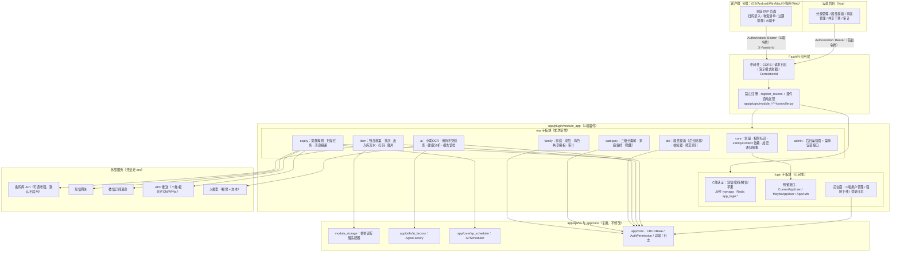
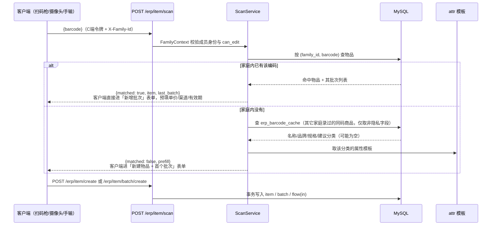
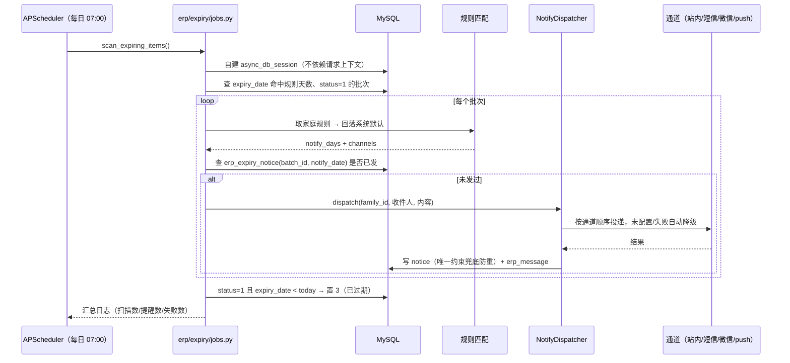
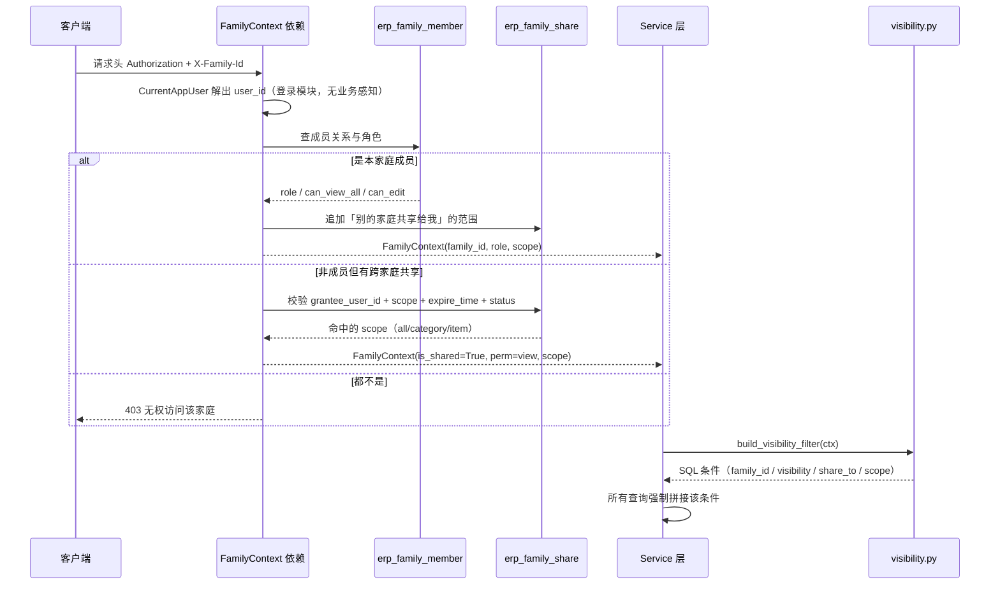

# C端家庭 ERP（家庭物资管理）实施方案

> 版本：v1.0　编写日期：2026-09-23　所属插件：`app/plugin/module_app/erp`
> 前置依赖：`app/plugin/module_app/login`（C端认证，已上线并通过冒烟）
> 数据库：MySQL 8.4.10　缓存：Redis　调度：APScheduler　AI：Agno（`app/utils/ai_factory.py`）

---

## 0. 一句话概述

在 `module_app` 下新增 `erp` 子板块，以**家庭（family）为资源归属主体**管理物资档案与进货批次，
分类与扩展属性由后台运营配置（三级分类 + 属性模板），C端用户录入并消费，
配套过期提醒、出入库流水、家庭共享授权、AI 健康分析与敏感信息加密。

---

## 1. 已确认的设计决策

| # | 决策项 | 结论 | 影响 |
|---|--------|------|------|
| 1 | 记录粒度 | **档案 + 批次两层** | `erp_item`（这是什么）+ `erp_item_batch`（每次进货），过期管理只查批次 |
| 2 | 扩展属性 | **仅后台运营配置，需支持筛选** | `attrs` JSON 存全量；筛选走 `family_id` 索引 + JSON 表达式，**不做 DDL 生成列**（单家庭 ≤1000 行，见下） |
| 3 | 家庭归属 | **一人可属多个家庭** | `family_id` 不进 JWT，请求头 `X-Family-Id` + `FamilyContext` 依赖解析 |
| 4 | 共享授权 | **户主自助 + 后台强制，两套都要** | `erp_family_share.source ∈ {family, admin}`，admin 记录户主不可自行撤销，双向审计 |
| 5 | 其它能力 | 扫码录入商品编码、多通道提醒、出入库流水、AI 健康分析（含成员健康档案）、字段级加密、多图 + OCR、分类可隐藏可自定义 —— **全部纳入范围** | 见 §11 分期 |
| 6 | 后台管理面路径 | `/api/v1/app/erp/admin/**` | 与 `login` 的 `/login/user/**` 同理，按「面向对象」分段 |
| 7 | 单家庭物品量级 | **千级，上限 1000 条** | 不引入 ES、不做生成列 DDL、普通分页即可 |
| 8 | 分类层级 | **三级硬上限** | 第 4 级请求返回 400，前后端同校验 |
| 9 | 录入方式 | **手动优先，扫码=录入商品编码** | 不对接第三方条码库（降为可选增强），扫码后端只做家庭内查重与批次归并 |

### 已确认的量级与录入方式（2026-09-23 用户确认）

- **量级：按千级算，单家庭物品最多 1000 条**（批次同量级）。直接结论：
  - 不引入 ES，不做分库分表，不需要游标分页（普通 `LIMIT/OFFSET` 足够，仍保留 `page_no/page_size` 约定）。
  - **放弃「filterable 属性建 MySQL 生成列 + DDL」方案**：单家庭行数极少，`WHERE family_id = ? AND JSON_UNQUOTE(JSON_EXTRACT(attrs,'$.x')) = ?` 走 `family_id` 索引后过滤即可，性能足够，且省掉运行时 DDL 的锁表风险和模板变更复杂度。`filterable` 标记退化为「是否出现在前端筛选面板」。
- **三级分类是硬上限**，第 4 级请求直接 400。
- **录入方式：手动录入优先，扫码是录入手段而非数据来源**。`barcode` 就是物品档案上的一个「商品编码」字段，扫码枪/摄像头扫出来的字符串直接填进该字段；后端用 `(family_id, barcode)` 查重 —— 命中已有物品则直接进「新增批次」流程，未命中则预填新建表单。**不对接第三方条码库**（降为可选增强，未配置 provider 时完全不启用）。
- **外部依赖需要凭证**：AI 模型 key（P4）、微信订阅消息模板 / APP push 凭证（P3 可选通道）。未配置时通道自动降级为「仅站内消息」，不阻塞主流程。

---

## 2. 插件外修改清单（重点，逐项告知）

> 本次已获豁免可改全工程，但每一处都列在这里，改动前后会再次向你确认。

| # | 文件 | 修改内容 | 必须性 | 不改的后果 / 替代方案 |
|---|------|----------|--------|----------------------|
| 1 | `app/config/setting.py:177` `WHITE_API_LIST_PATH` | 追加 `/api/v1/app/login/*`、`/api/v1/app/erp/*`（或改为从环境变量读取白名单） | **必须** | `DEMO_ENABLE=true` 时 `RequestLogMiddleware` 会拦掉所有 C端非 GET 请求 → 注册/登录/录入全 500。替代：生产永不开演示模式（不推荐） |
| 2 | `app/core/ap_scheduler.py:144-151` `init_scheduler` | 追加注册 `erp_expiry_scan`（每日 07:00）、`erp_stock_alert_scan`（每日 08:00）两个系统任务 | 推荐 | 替代方案：插件 controller 导入时调 `APScheduler.register_system_job(...)`（`register_routers()` 早于 lifespan，APScheduler 未 start 时 add_job 进 pending 队列，可行但属导入副作用） |
| 3 | `app/alembic/versions/xxxx_erp_tables.py` | 新增迁移脚本（ERP 全部表 + 索引） | 生产必须 | dev 环境靠启动 `create_tables()` 自动建表；生产需要可回滚的迁移 |
| 4 | `env/.env.dev`、`env/.env.example` | 新增 ERP 环境变量：加密密钥、扫描时刻、提醒通道、AI 模型（条码库为可选增强项） | **必须** | 配置项，非代码；缺失时按 §10 默认值降级 |
| 5 | `tests/test_app_route_guard.py` | 新增鉴权兜底测试：遍历 `app.openapi()`，断言 `/app/**` 每个路由都挂了 `AppAuth`/`OptionalAppAuth`，后台路由都挂了 `AuthPermission` | 强烈建议 | 漏挂依赖 = 裸接口。插件内拿不到 `app` 对象，只能在 `tests/` 做 |
| 6 | 后台菜单/权限数据（`sys_menu`） | **不改插件外文件**：由插件提供幂等安装接口 `POST /api/v1/app/erp/admin/menu/install`，超管调用一次即写入 ERP 后台菜单与 `module_app:erp:*` 权限 | — | 现有 `app/scripts/initialize.py` 的种子 JSON 仅在表为空时生效，对已部署库无效，所以走接口安装 |

**明确不需要改的**（已核实）：

- `app/api/v1/module_storage` —— `StorageSourceService.get_active_source()`（`source/service.py:172`）无权限耦合，C端上传接口在插件内包一层、传系统级 `AuthSchema()` 即可复用。
- `app/api/v1/module_ai` —— 不复用 `ChatService`（它绑后台会话表与 `auth.user.username`），直接用 `app/utils/ai_factory.py:AgnoFactory.create_agent(user_id, team_id, session_id, db=None, model_config=...)` 做无状态调用。
- `app/core/dependencies.py`、`app/core/middlewares.py` —— C端鉴权走插件自有依赖；全工程无限流中间件（`register_docs` 的「豁免限流」注释是历史遗留）。
- `app/utils/import_util.py` —— `find_models` 会 walk 到 `app/plugin`，ERP 模型自动进 alembic 元数据，无需登记。

---

## 3. 总体架构图



**分层原则**

1. `login` 只提供**身份**（我是谁、哪个端、会话是否有效），不含任何业务语义；`erp` 提供**上下文**（我在哪个家庭、什么角色、能看什么）。
2. `erp/core/deps.py` 的 `FamilyContext` 是唯一的家庭权限入口，所有 service 通过它生成可见性 SQL 条件，禁止在 controller 里手写 `family_id` 过滤。
3. 外部能力（推送、短信、AI，以及可选的条码库）一律走**适配器 + env 配置**，未配置时降级而非报错；核心录入链路不依赖任何外部服务。
4. 后台面与 C端面共用 model/crud/service，只分 controller 与鉴权依赖（沿用 `login` 已验证的做法）。

---

## 4. 数据模型

### 4.1 ER 图

```mermaid
erDiagram
    app_user ||--o{ erp_family_member : "加入"
    erp_family ||--o{ erp_family_member : "拥有成员"
    erp_family ||--o{ erp_item : "拥有物品"
    erp_family ||--o{ erp_family_share : "对外共享"
    erp_category ||--o{ erp_category : "父子（最多三级）"
    erp_category ||--o{ erp_attr_template : "属性模板"
    erp_category ||--o{ erp_item : "归类"
    erp_item ||--o{ erp_item_batch : "进货批次"
    erp_item ||--o{ erp_item_flow : "出入库流水"
    erp_item_batch ||--o{ erp_item_flow : "批次变动"
    erp_item_batch ||--o{ erp_expiry_notice : "过期提醒"
    erp_family ||--o{ erp_expiry_rule : "提醒规则"
    erp_family ||--o{ erp_message : "站内消息"
    app_user ||--o{ erp_device : "推送设备"
    erp_family ||--o{ erp_member_profile : "成员健康档案"
    erp_family ||--o{ erp_ai_report : "AI 报告"
    erp_family ||--o{ erp_share_audit : "共享审计"

    erp_family {
        bigint id PK
        string name "家庭名称"
        bigint owner_user_id "户主"
        string invite_code UK "邀请码"
        int member_limit "成员上限"
        int status "0正常 1停用"
    }
    erp_family_member {
        bigint id PK
        bigint family_id FK
        bigint user_id FK
        string role "owner/admin/member"
        bool can_view_all "可见全部物资"
        bool can_edit "可编辑"
        bool can_share "可对外共享"
        string remark "家庭内备注（如：妈妈）"
    }
    erp_family_share {
        bigint id PK
        bigint family_id FK "授权方家庭"
        string source "family/admin"
        bigint grantor_user_id "授权人（admin 时为运营账号）"
        bigint grantee_user_id "被共享用户（二选一）"
        bigint grantee_family_id "被共享家庭（二选一）"
        string scope "all/category/item"
        bigint scope_id "范围目标ID"
        string perm "view/edit"
        datetime expire_time "到期自动失效"
    }
    erp_category {
        bigint id PK
        bigint parent_id FK "null=一级"
        int level "1/2/3 硬校验"
        string name
        string code UK "如 medicine.antipyretic"
        bigint family_id "null=系统预置"
        string icon
        int sort
        int is_sensitive "1=证件类，默认私有"
    }
    erp_attr_template {
        bigint id PK
        bigint category_id FK
        string field_key "同分类下唯一"
        string field_label
        string field_type "text/number/date/enum/bool/image/member"
        json options "枚举项/取值范围"
        string unit
        bool required
        bool filterable "1=可用于筛选面板（不触发DDL）"
        int version "模板版本"
    }
    erp_item {
        bigint id PK
        bigint family_id FK
        bigint category_id FK
        string name
        string barcode "商品条码"
        string brand
        string spec "规格"
        string unit "计量单位"
        json images "多图"
        string purchase_channel "购买渠道"
        decimal ref_price "参考价"
        bigint owner_user_id "归属人"
        string location "存放位置"
        string visibility "family/member/private"
        json share_to "visibility=member 时的用户ID列表"
        json attrs "扩展属性（按模板校验）"
    }
    erp_item_batch {
        bigint id PK
        bigint item_id FK
        bigint family_id FK "冗余，便于按家庭扫描"
        decimal quantity "进货数量"
        decimal remain_qty "剩余数量"
        decimal unit_price
        datetime purchase_time
        string channel
        date production_date
        date expiry_date "过期管理核心字段"
        int status "1在用 2耗尽 3过期 4丢弃"
    }
    erp_item_flow {
        bigint id PK
        bigint item_id FK
        bigint batch_id FK
        string flow_type "in/out/expire/discard/gift/adjust"
        decimal quantity
        decimal before_qty
        decimal after_qty
        bigint operator_user_id
        string idempotent_key UK "幂等键"
    }
    erp_expiry_rule {
        bigint id PK
        bigint family_id "null=系统默认"
        bigint category_id "null=全分类"
        json notify_days "[30,7,3,1,0]"
        json channels "[inapp,sms,wechat,push]"
        bool enabled
    }
    erp_expiry_notice {
        bigint id PK
        bigint batch_id FK
        date notify_date "唯一约束 batch_id+notify_date 防重推"
        json channels_sent
        int status "0待发 1已发 2失败"
    }
    erp_member_profile {
        bigint id PK
        bigint family_id FK
        bigint user_id "可为空（家庭内非注册用户，如老人小孩）"
        string member_name
        date birth_date
        string gender
        json chronic "慢病（加密）"
        json allergies "过敏史（加密）"
        json medications "长期用药（加密）"
        bool pregnant
        bool consent_ai "AI 分析同意"
        datetime consent_time
    }
    erp_ai_report {
        bigint id PK
        bigint family_id FK
        bigint user_id FK
        string scene "receipt_ocr/medicine_check/health_analysis"
        json input_snapshot "输入快照（可追溯）"
        string model
        string prompt_version
        json output
        string risk_level "info/warn/danger"
        text disclaimer
    }
    erp_device {
        bigint id PK
        bigint user_id FK
        string platform "复用 AppPlatform"
        string push_token
        int status
    }
    erp_message {
        bigint id PK
        bigint family_id FK
        bigint user_id FK
        string type "expiry/stock/share/system"
        string title
        string content
        string ref_type
        bigint ref_id
        bool is_read
    }
    erp_barcode_cache {
        string barcode PK
        string name
        string brand
        string spec
        bigint category_id "自动归类建议"
        string source "family/barcode_api/ai_ocr"
        json raw "来源原始数据（仅非隐私字段）"
    }
    erp_share_audit {
        bigint id PK
        bigint family_id FK
        bigint actor_user_id
        string actor_type "family/admin/system"
        string action "grant/revoke/expire"
        string target_type
        bigint target_id
        json before
        json after
    }
```



### 4.2 模型层约定（与 login 一致）

- 所有表继承 `ModelMixin`（id/uuid/is_deleted/created_time/updated_time/deleted_time），**不继承 `UserMixin`**。
  原因：`UserMixin` 的 `created_id/updated_id` 是指向 `sys_user` 的外键，且后台 `Permission._filter_by_data_scope` 会按 `created_id` 过滤数据范围 —— C端用户不在 `sys_user` 里，混用会 FK 失败或被误过滤。
- 操作人统一记为普通整型列 `created_by` / `operator_user_id`（无外键），指向 `app_user.id`。
- 软删除：物品/批次/分类/模板走软删；流水、审计、消息、AI 报告**不软删**（审计价值），参考 `AppLoginLogModel` 的做法（不声明 `deleted_id` 即物理删）。

---

## 5. 目录结构（含每个文件职责）

```
app/plugin/module_app/
├── __init__.py                     # 插件入口：re-export login + erp 公开符号
├── plugin.toml
├── login/                          # ← 已完成，本次仅新增注销钩子
│   ├── core/
│   │   └── hooks.py                # 【新增】模块生命周期钩子注册表（注销前检查/注销后清理）
│   └── auth/
│       ├── controller.py           # 【新增】POST /login/account/cancel 账号注销
│       └── service.py              # 【新增】注销流程：校验钩子 → 清会话 → 软删用户
└── erp/                            # ← 本次新增
    ├── __init__.py                 # 子板块入口：re-export FamilyContext / CurrentFamily / ErpPerm
    ├── core/
    │   ├── __init__.py
    │   ├── constants.py            # 枚举（角色/可见性/流水类型/提醒通道/AI场景）、ErpPerm 权限标识、env 可调项、Redis key
    │   ├── deps.py                 # FamilyContext + CurrentFamily/OptionalFamily 依赖；后台面 AdminErp 依赖
    │   ├── visibility.py           # 可见性 SQL 条件构造器（唯一允许写 family_id 过滤的地方）
    │   ├── crypto.py               # 敏感字段加密（Fernet，独立密钥 APP_ERP_SECRET）+ 检索用 hash 影子列
    │   ├── attrs.py                # 属性模板校验器（类型/必填/枚举/单位）+ filterable 筛选表达式构造（JSON 提取，不用生成列）
    │   └── notify/
    │       ├── base.py             # NotifyChannel 协议 + 分发器（按规则选通道，失败降级）
    │       ├── inapp.py            # 站内消息（唯一默认实现）
    │       ├── sms.py              # 短信（复用 login 的 sender）
    │       ├── wechat.py           # 微信订阅消息（未配置则跳过）
    │       └── push.py             # APP 推送（未配置则跳过）
    ├── family/
    │   ├── model.py                # erp_family / erp_family_member / erp_family_share / erp_share_audit
    │   ├── schema.py
    │   ├── crud.py
    │   ├── service.py              # 建家庭/邀请加入/成员角色变更/共享授权（family 与 admin 两套）/可见性判定
    │   └── controller.py           # C端：我的家庭、切换、成员管理、邀请码、共享授权
    ├── category/
    │   ├── model.py                # erp_category / erp_family_category_pref
    │   ├── schema.py
    │   ├── crud.py
    │   ├── service.py              # 三级树 CRUD、层级校验、家庭隐藏、自定义分类挂载
    │   └── controller.py           # C端只读树 + 偏好；后台面在 admin/
    ├── attr/
    │   ├── model.py                # erp_attr_template
    │   ├── schema.py
    │   ├── crud.py
    │   ├── service.py              # 模板 CRUD、版本管理、模板变更对历史数据的处理规则
    │   └── controller.py           # C端：按分类拉取表单定义（渲染用）
    ├── item/
    │   ├── model.py                # erp_item / erp_item_batch / erp_item_flow / erp_barcode_cache
    │   ├── schema.py
    │   ├── crud.py
    │   ├── service.py              # 档案与批次 CRUD、列表/搜索/筛选、库存聚合
    │   ├── flow.py                 # 出入库流水与库存扣减（幂等）
    │   ├── scan.py                 # 商品编码录入：家庭内 (family_id, barcode) 查重、命中则归并到新增批次、跨家庭录入建议缓存
    │   ├── upload.py               # C端图片上传（包装 StorageFileService，限目录/mime/大小）
    │   └── controller.py           # C端物资全部接口
    ├── expiry/
    │   ├── model.py                # erp_expiry_rule / erp_expiry_notice / erp_message / erp_device
    │   ├── schema.py
    │   ├── crud.py
    │   ├── service.py              # 规则匹配、即将过期查询、提醒投递、防重推
    │   ├── jobs.py                 # scan_expiring_items() / scan_low_stock()：自建 async_db_session
    │   └── controller.py           # C端提醒设置与消息中心
    ├── ai/
    │   ├── model.py                # erp_ai_report / erp_member_profile
    │   ├── schema.py
    │   ├── crud.py
    │   ├── prompts.py              # 提示词与 prompt_version 常量（版本化，便于追溯）
    │   ├── service.py              # 小票OCR / 用药冲突检查 / 健康分析；同意校验 + 报告留档 + 免责声明
    │   └── controller.py           # C端 AI 接口（含流式与非流式）
    └── admin/
        ├── schema.py
        ├── service.py              # 运营面：分类与模板配置、家庭管理、共享干预、审计查询、菜单安装
        └── controller.py           # 后台路由：/erp/admin/**（AuthPermission + OperationLogRoute）
```

**路径命名**（遵循「扁平、无重复语义」）：

```
C端    /api/v1/app/erp/family/*        我的家庭、成员、邀请、共享
       /api/v1/app/erp/category/tree   分类树（只读）
       /api/v1/app/erp/attr/form       某分类的录入表单定义
       /api/v1/app/erp/item/*          物品与批次（含 /item/scan、/item/upload、/item/flow）
       /api/v1/app/erp/expiry/*        即将过期、提醒规则
       /api/v1/app/erp/message/*       站内消息中心
       /api/v1/app/erp/ai/*            OCR、健康分析
后台   /api/v1/app/erp/admin/category/*    分类维护
       /api/v1/app/erp/admin/attr/*        属性模板维护
       /api/v1/app/erp/admin/family/*      家庭与成员管理、强制共享
       /api/v1/app/erp/admin/audit/*       共享与敏感访问审计
       /api/v1/app/erp/admin/menu/install  幂等安装后台菜单与权限
```

---

## 6. 关键流程

### 6.1 录入（手动优先，扫码只是输入商品编码的手段）



**要点**

- `barcode` 是**物品档案的普通字段**（商品编码），不是外部主数据键。扫码只是把手输换成扫一下，后端不依赖任何第三方条码服务。
- 查重范围是**家庭内**：同一个条码在不同家庭是各自独立的物品记录。`erp_barcode_cache` 只做「录入建议」（名称/品牌/规格/分类），跨家庭共享这些非隐私字段可以显著降低第二次录入的成本；缓存内容不含价格、数量、有效期等家庭私有数据。
- 扫到已存在的物品时**默认走新增批次**（这正是「每次进货」的语义），而不是新建重复物品；用户可显式选择「另存为新物品」。
- 无条码的商品（散装蔬菜、自制物品）直接手动录入，`barcode` 允许为空；为避免重复建档，前端在名称输入时调 `/erp/item/suggest` 做同家庭名称模糊匹配提示。
- 小票/说明书 OCR 自动填属性属于 P4 的 AI 增强，不在这条主链路上，AI 不可用时录入流程完全不受影响。

### 6.2 过期扫描与提醒



**收件人规则**：默认发给该物品的 `owner_user_id` 与家庭 `owner`；`visibility=private` 的物品只发归属人。

### 6.3 家庭共享鉴权



---

## 7. 动态属性方案（决策 2 的落地）

**为什么不用 EAV**：家庭物资的主流查询是「按分类浏览 + 搜名称 + 看快过期」，EAV 会让列表查询 join N 次，且分页排序极难写。

**为什么也不用生成列 + DDL**：单家庭物品上限 1000 条（§1），`family_id` 索引过滤后剩余行数极小，JSON 表达式过滤的代价可以忽略；而运行时 `ALTER TABLE` 带来的锁表风险、模板变更与 DDL 的同步问题，远大于收益。

**方案：JSON 全量 + `family_id` 索引 + 表达式过滤**

```sql
-- erp_item 只需要这两个索引即可覆盖全部列表查询
CREATE INDEX idx_item_family_category ON erp_item (family_id, category_id, is_deleted);
CREATE INDEX idx_item_family_name     ON erp_item (family_id, name);

-- filterable 属性的过滤在 family_id 命中后做，单家庭 ≤1000 行，无需为属性单独建索引
SELECT id, name, attrs FROM erp_item
 WHERE family_id = :fid AND is_deleted = 0
   AND JSON_UNQUOTE(JSON_EXTRACT(attrs, '$.approval_no')) = :val;
```

- `filterable=true` 的语义**只是**「该属性出现在 C端筛选面板 / 后台可配为列表列」，不触发任何 DDL。
- 未标 `filterable` 的属性只在详情页展示，不参与查询。
- 写入时按模板校验：类型、必填、枚举取值、数值范围、日期格式；不认识的 `field_key` 直接丢弃并记 warning（防止前端塞脏数据）。
- **模板变更的历史数据规则**：删字段 → 历史 `attrs` 保留但不展示、不校验；改类型 → 旧值降级为字符串只读，新值按新类型校验；模板 `version` 自增，物品记录 `attr_version` 以便追溯。
- 日期/数值类属性统一存**字符串化的标准格式**（`YYYY-MM-DD`、十进制数字字符串），保证 JSON 提取后可直接比较与排序；由 `core/attrs.py` 在校验阶段强制归一化。
- 若将来单家庭物品量级涨到万级以上，再把高频 `filterable` 字段升级为生成列 —— 因为过滤逻辑集中在 `core/attrs.py` 一处，届时只改这一个文件。

---

## 8. 权限模型

### 8.1 家庭内角色矩阵

| 能力 | owner（户主） | admin（管理员） | member（成员） | 被共享者（跨家庭） |
|------|:---:|:---:|:---:|:---:|
| 查看 `visibility=family` 物资 | ✅ | ✅ | ✅ | 按 scope |
| 查看他人 `private` 物资 | ❌ | ❌ | ❌ | ❌ |
| 新增/编辑物资 | ✅ | ✅ | 需 `can_edit` | 需 `perm=edit` |
| 出入库/消耗登记 | ✅ | ✅ | ✅ | ❌ |
| 邀请成员 | ✅ | ✅ | ❌ | ❌ |
| 移除成员 / 转让户主 | ✅ | ❌ | ❌ | ❌ |
| 对外共享授权 | ✅ | 需 `can_share` | ❌ | ❌ |
| 修改提醒规则 | ✅ | ✅ | ❌ | ❌ |
| 查看敏感分类（证件/银行卡） | 需显式放开 | 需显式放开 | ❌ | ❌ |

`can_view_all=false` 的成员：只能看到 `visibility=family` 或 `owner_user_id=自己` 或 `share_to` 含自己的物品。

### 8.2 共享授权冲突规则（决策 4）

- `source=family`：户主/有 `can_share` 的管理员创建，可自助撤销；后台可见、可强制回收。
- `source=admin`：运营在后台创建（客服/监管场景），**户主不可自行撤销**，只能提交申请；必须带 `expire_time`（默认 30 天，最长 90 天），到期自动失效并由扫描任务置 `status=2`。
- 两类授权都写 `erp_share_audit`，`actor_type` 区分 `family/admin/system`。
- 被共享者默认 `perm=view`（只读）；`edit` 需显式授予且不可用于敏感分类。

### 8.3 后台权限标识（需在菜单管理中登记，或用安装接口）

```
module_app:erp:category:query|create|update|delete
module_app:erp:attr:query|create|update|delete
module_app:erp:family:query|detail|update|delete|member
module_app:erp:share:query|grant|revoke
module_app:erp:audit:query
module_app:erp:item:query|delete          # 运营侧客服排障用
module_app:erp:menu:install               # 仅超管
```

---

## 9. 安全与合规

1. **敏感字段加密**：证件号、银行卡号、健康档案（慢病/过敏/用药）用 `erp/core/crypto.py`（Fernet，密钥 `APP_ERP_SECRET`，**不复用** `module_storage` 的存储密码密钥，隔离爆炸半径）。加密列不可 DB 端筛选 → 需要精确查找时额外存 `xxx_hash`（HMAC-SHA256）影子列做等值匹配。
2. **敏感访问审计**：读取证件类/健康档案写 `erp_share_audit`（`target_type=sensitive_read`）。
3. **C端上传收敛**：`item/upload.py` 强制 `remote_path=erp/{family_id}/`，校验 mime 白名单与大小，复用 `UploadUtil` 的路径穿越与危险扩展名检查；不暴露 `source_id` 参数给 C端（固定默认存储源）。
4. **AI 合规**：健康分析必须先有 `consent_ai=true` 与 `consent_time`；报告落 `erp_ai_report`（含 `input_snapshot` 与 `prompt_version` 可追溯）；输出必带免责声明与 `risk_level`；`risk_level=danger`（如药物冲突、过期药）前端强提示。提示词禁止让模型下诊断结论，只做「风险提示 + 建议咨询医生」。
5. **账号注销**：`login` 新增 `core/hooks.py` 注册表，ERP 注册 `can_delete_user(user_id)`（是户主且家庭还有其他成员 → 要求先转让）与 `on_user_deleted(user_id)`（移除成员关系、清理共享、匿名化健康档案）。login 不 import 任何业务模块，避免反向耦合。
6. **鉴权兜底**：`tests/test_app_route_guard.py` 遍历 openapi，断言无「裸接口」。
7. **幂等**：出入库流水带 `idempotent_key`（客户端生成），防止弱网重试导致库存重复扣减；过期提醒靠 `(batch_id, notify_date)` 唯一约束防重推。

---

## 10. 环境变量（新增，写入 `env/.env.dev` 与 `.env.example`）

```ini
# ── 家庭 ERP ────────────────────────────────────────────
APP_ERP_SECRET = "change-me-32bytes-min"      # 敏感字段加密密钥（必须，缺失则敏感接口拒绝写入）
APP_ERP_FAMILY_MEMBER_LIMIT = 10              # 单家庭成员上限
APP_ERP_SCAN_EXPIRY_CRON = "0 7 * * *"        # 过期扫描时刻
APP_ERP_SCAN_STOCK_CRON = "0 8 * * *"         # 低库存扫描时刻
APP_ERP_EXPIRY_DEFAULT_DAYS = "[30,7,3,1,0]"  # 系统默认提醒天数
APP_ERP_STOCK_ALERT_DEFAULT = 2               # 默认低库存阈值

# ── 条码库（可选增强，默认不启用；不启用时扫码仅做家庭内查重）──
APP_ERP_BARCODE_PROVIDER = ""                 # 留空=不启用
APP_ERP_BARCODE_API_URL = ""
APP_ERP_BARCODE_API_KEY = ""

# ── 通知通道（未配置自动降级为仅站内消息）─────────────────
APP_ERP_NOTIFY_CHANNELS = "inapp"             # inapp,sms,wechat,push
APP_ERP_WX_SUBSCRIBE_TEMPLATE = ""
APP_ERP_PUSH_PROVIDER = ""                    # getui/jpush/fcm/apns
APP_ERP_PUSH_APP_KEY = ""
APP_ERP_PUSH_MASTER_SECRET = ""

# ── AI ──────────────────────────────────────────────────
APP_ERP_AI_MODEL = ""                         # 留空则用 AgnoFactory 默认 active 模型
APP_ERP_AI_VISION_MODEL = ""                  # 小票/说明书 OCR 用视觉模型
APP_ERP_AI_ENABLED = true
APP_ERP_AI_DAILY_LIMIT = 20                   # 单用户每日调用上限（成本护栏）
```

---

## 11. 分期计划

| 期 | 内容 | 交付物 | 依赖 |
|----|------|--------|------|
| **P0 地基** | `erp/core`（常量/依赖/可见性/加密）+ `family`（家庭、成员、共享、审计）+ `category` 三级树 + `attr` 属性模板 | 可建家庭、加成员、授权共享、后台配好分类与模板 | 插件外改动 #1 #4 |
| **P1 录入** | `item`（档案 + 批次）+ 手工录入 + 商品编码扫码录入（家庭内查重 → 命中归并批次 / 未命中预填新建）+ 图片上传 | C端能录一件带图、带编码、带有效期的物资 | P0、存储源已配置 |
| **P2 管理** | 列表/搜索/`filterable` 属性筛选（JSON 表达式，无 DDL）+ 出入库流水 + 消耗扣减 + 分类偏好 | 物资清单可用、库存准确 | P1 |
| **P3 过期** | `expiry`（规则、扫描任务、消息中心）+ 通知通道抽象（站内先行，短信复用 login，微信/push 预留） | 每日自动提醒快过期物资 | P2、插件外改动 #2 |
| **P4 AI** | 小票 OCR 录入 + 用药冲突检查 + 健康分析（成员档案 + 同意 + 报告留档） | AI 增值服务 | P2、AI key |
| **P5 运营面** | `admin`（分类/模板/家庭/共享干预/审计）+ 菜单安装接口 + alembic 迁移 | 运营可自助配置 | P0-P3、插件外改动 #3 #6 |
| **P6 加固** | 敏感字段加密落地 + 账号注销钩子 + 鉴权兜底测试 + 压测与索引调优 | 可上线 | 全部、插件外改动 #5 |

建议按 P0 → P1 → P2 → P3 先跑通闭环（这四期不依赖任何外部凭证），P4/P5/P6 可并行。

---

## 12. 风险登记

| 风险 | 影响 | 缓解 |
|------|------|------|
| 单家庭物品量级若远超 1000 条（用户口径外的异常家庭） | JSON 表达式过滤变慢 | 列表接口按 `family_id` 索引先行过滤；`core/attrs.py` 集中过滤逻辑，量级涨到万级时只改这一处升级为生成列 |
| 同一商品在不同家庭重复建档、名称写法不统一 | 录入建议命中率低、统计口径乱 | `erp_barcode_cache` 沉淀跨家庭非隐私字段做录入建议；名称模糊匹配提示；分类由后台统一维护，家庭自定义分类需挂在系统二级下 |
| 条码库为可选增强，未接入时新建物品全靠手输 | 首次录入成本略高 | 手动录入本就是主路径（用户确认）；`erp_barcode_cache` 让同码商品第二次录入近乎零成本；P4 的小票 OCR 进一步降本 |
| 推送通道需要企业资质（微信订阅消息要模板审核、APNs 要证书） | P3 部分通道延后 | 站内消息为默认必达通道，其余降级 |
| AI 健康建议的医疗合规风险 | 法律风险 | 只做风险提示不下诊断；强制免责声明；`input_snapshot` 留档；每日调用限额 |
| 一人多家庭导致的越权面扩大 | 数据泄露 | 所有查询必经 `visibility.py`；`tests` 兜底；跨家庭共享默认只读 + 到期失效 |
| 插件自动发现会 include 模块内**所有** `APIRouter` 实例 | 误暴露内部 router | 不在模块顶层创建未打算公开的 router（`login` 已踩过的点，写成规范） |
